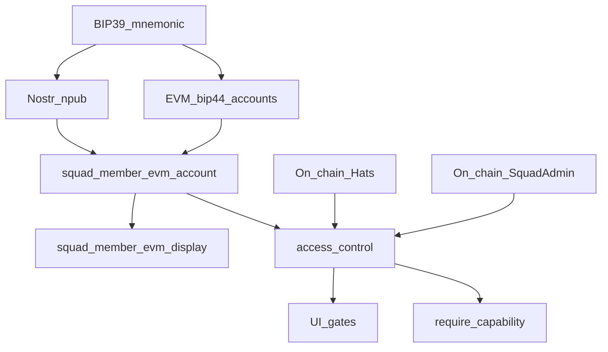
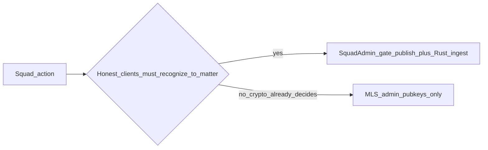

# Squad access control (Nostr ↔ EVM ↔ Hats / Squad Admin)

Normative rules for *who may perform action X on squad Y* in the desktop app. On-chain contracts remain final authority; this layer fail-closes before signing and drives UI disable reasons.

## Identity binding

1. One Nostr identity (npub) per unlocked account.
2. Many EVM keys may derive from the same BIP-39 phrase (`bip44_v1`, squad purpose).
3. Per-squad **binding** `(parent_id, member_npub) → evm_account_id` (`squad_member_evm_account`) is consent via **#personal-alerts**. After bind, the roster key signs an off-chain EIP-712 bind cert and the client publishes `squad_member_evm_share` v2 → local share row `squad_member_evm` for Crew display. Peers may gossip those certs in `squad_evm_roster_snapshot` on Request sync. The cert is **display + gossip only**; it is not a capability grant. The EIP-712 domain uses `chainId = 0` and `verifyingContract = address(0)`, so certs are chain-agnostic and replayable; ACL never reads the cert for capability.
4. **ACL** (access control) resolves identity from the **binding only** (v1): load the bound account’s address. A share row, bind cert, or WalletBar Default without a binding is **not** squad identity. Multi-key “any of my bip44 keys wears the hat” is out of scope. Hats still confirm roles on the bound address (`isWearer`).

**Fail closed:** if the current npub has no `squad_member_evm_account` for `parent_id`, every capability is denied (`ACL_UNBOUND`), including permissionless execute — even if a legacy share row exists. Signing paths must not fall back to an unbound personal signer or invent roster identity from the active Default.

**ACL** = access control (classically *access control list*). In Pacto it names this layer: squad EVM binding + Hats / Squad Admin capability checks before signing (`require_capability`, UI snapshot). Error codes `ACL_DENIED` / `ACL_UNBOUND` use the same shorthand. It is not a separate on-chain contract. Member-facing UI says “squad EVM” / “squad key,” not “roster.”

## Enforcement

| Layer | Role |
|-------|------|
| Rust `require_capability` | Source of truth before gov / Squad Admin / tracked-token mutations |
| UI gates | Advisory; same predicates via `get_squad_capabilities` snapshot (viewer self-check). MLS `squad_gov_replica` / `governance_process_updated` snapshots are display only — never a capability grant. Revalidate the local viewer on process nonce and when displayed squad EVM changes; retry once if wearer lists disagree with the snapshot so post-bootstrap hat mints do not leave stale CTAs. Snapshot fetch `error` is fail-closed for CTAs (same one-shot retry). |
| Contracts | Final reject / accept |

Tauri IPC is not a security boundary if only the UI gates.

### Code map

| Piece | Path |
|-------|------|
| Module | `src-tauri/src/evm/access_control/` |
| Shared gov send | `gov_module_write::send_gov_module_call` (capability + write lock + `chain_id`) |
| Squad Admin writes | `squad_admin_write.rs` (parent from infra / payload; no personal-signer fallback) |
| Packed role encode/decode | `privilege_role_id` (TS + Rust); Crew UI `CrewPrivilegesSection` |
| MLS/Commons privilege enforce | `squad-privilege-enforce.ts` + Rust `squad_privilege_enforce` (optional `privilegeParentId` on invite) |
| Tracked tokens | `db::upsert_squad_tracked_token` / `remove_squad_tracked_token` |
| UI snapshot | `get_squad_capabilities` → `governance-privilege.ts` / `PactoGovGovernanceShell` |

Member-facing disable/fail copy is i18n’d (`governance.gate.*`, `govWriteErrorMessage` for `ACL_*` / sponsor codes). This doc stays the operator source for hat/ACL mechanics — not a UI copy catalog.

Hat IDs and Safe / Squad Admin addresses come from the registry deployment for the parent’s infra row (`chain` + `canonical_ref` top hat): live `#dashboard` uses `pacto_gov` + NavePirataRegistry; the Wargame hub uses `pacto_gov_wargame` + WarGameRegistry.

Write routing to `GovStack::WarGame` does **not** trust MLS `war_game_updated` JSON. A local `pacto_gov_wargame` payload may hint that `to` is a war-game module; `require_capability` and sponsored UserOps only follow that hint after a fresh `WarGameRegistry.active(keccak256(parentId))` read lists `to`. A mismatch (including a poisoned production address in the payload) stays on the live stack. RPC failure while the payload claims a war-game target fails the write closed.

## Capabilities

| Capability | Required check |
|------------|----------------|
| `proposeTreasury` | Captain **or** Crew hat |
| `crewVote` | Crew hat |
| `captainVote` | Captain hat (blocked when Safe holds captain and signer does not) |
| `executeTreasury` | Roster EVM linked (permissionless once thresholds met) |
| `startMutiny` / `castMutinyVote` | Crew hat |
| `executeMutiny` | Roster EVM linked |
| `captainResign` | Captain hat |
| `quartermasterMutateCrew` | Captain hat (on-chain also blocks while mutiny mode) |
| `quartermasterExecute` | Roster EVM linked |
| `mutateTrackedTokens` | Captain **or** Crew hat |
| `squadAdminCreateRole` / `squadAdminEnableExecutor` / `squadAdminEnableFull` | Captain hat |

Squad Admin executor flags (`FULL`, `PAUSE`, custom tags) appear on the capability snapshot for UI; granting those roles is captain-gated today (1st Mate signing is deferred).

### Packed privilege roles (Crew → Privileges)

Custom catalog roles pack a short name + action flags into `bytes32` (pacto-gov SquadAdmin encoding v1). Decode/encode lives in `privilege-role-id` (TS + Rust). Effective flags OR across enabled catalog roles; `FULL` grants all known actions; `PAUSE` overrides. Privilege decisions (publish and MLS arrival) read executor roles on the trusted RPC. Crew catalog and dashboard role labels keep the squad RPC list.

| Action flag | Publish / UI preflight | Receive (arrival-time) |
|-------------|------------------------|-------------------------|
| `inviteAccept` | Consent-first invite, admit, join accept, channel invite, state-sync open-channel admit, restore of a missing open channel; Rust `invite_member_to_group` when `privilegeParentId` is set. MLS-admin resend and restore of an existing leaf stay unchecked | Outbound invite / admit-needed / join-response MLS applies |
| `createChannel` | Create-channel flow and catalog send, including state-sync republish | Channels catalog MLS apply |
| `broadcast` | Commons broadcast + `resolveCanBroadcastSquad` | Publish-gated today; Alpha target: honest ingest/display filter (see Enforceability) |
| `manageNetwork` | Network + RPC share publish | Network / RPC MLS apply |

**Inactive SquadAdmin** (no resolvable proxy in local infra): all of the above allow. **Active SquadAdmin**: require roster binding + FULL or the flag; unbound / RPC failure / pause / missing flag → deny. Receive paths ignore event `created_at` and fail closed when the author npub is missing while SquadAdmin is active. Join-inbox holder FULL gate is unchanged (separate path).

## Enforceability (on-chain recognition vs MLS)

Alpha bar for **on-chain-enforceable** packed privileges: when SquadAdmin is active, honest Pacto clients refuse to **recognize / merge / surface** the action as valid squad product state if the author’s roster-bound EVM lacks the flag. Force is **publish preflight + Rust ingest**, not frontend-only. A forked client may still emit MLS ciphertext; peers simply do not adopt the side effect.

**MLS-only** means authority lives in the MLS engine (`admin_pubkeys`, leaf Add/Remove/Restore, group commits). Once someone is an MLS admin of an existing group, chain flags cannot stop a hostile client from using that power. Product UX may still prompt with privileges; that is not real force.

Privileges gate **recognition of product actions**. MLS admin gates **group crypto ops**. If a squad makes everyone an MLS admin for easier sync, on-chain “only these people may admin” does **not** work — do not design Privileges as a substitute for MLS admin.

Raw IPC that bypasses product flows (`create_group_chat` without catalog, Commons publish without TS) is **not** a security boundary for hostile local users; peer recognition is.

Hats / `require_capability` (treasury, mutiny, SquadAdmin **role management**) stay contract-final for **signing**. That path is already on-chain and outside this recognition vs MLS matrix.

### Chain-enforceable (recognition)

| Action | Why force works | Today | Alpha target |
|--------|-----------------|-------|--------------|
| `createChannel` | Open channels only appear via catalog / create flow peers merge | TS publish + TS receive (`applyPrivilegedMlsAction`); raw `create_group_chat` ungated | Keep as chain class; catalog and related structured checks in **Rust ingest** |
| `manageNetwork` | Network/RPC share only affects local squad config if merged | TS publish + TS receive | Rust ingest parity |
| `inviteAccept` (consent invite, admit, join **response**, structured admit signals) | Honest clients skip applying those structured side effects without the flag | TS + Rust invite when `privilegeParentId` is set; receive FE-only | Chain class for structured admit/invite product state; Rust ingest for those payloads |
| `broadcast` | Commons rows can be ignored by honest clients if author lacks flag | Publish UI only; Rust/Commons ingest ungated | Filter publish **and** honest ingest/display; not MLS crypto |

### MLS-only (cannot meaningfully force on-chain)

| Action | Why chain does not force |
|--------|---------------------------|
| MLS Add / Remove / Restore leaf in an **existing** group | Engine membership; hostile MLS admin can commit regardless of SquadAdmin |
| Who is MLS `admin_pubkeys` (including “everyone admin for easier sync”) | Crypto admin set; on-chain “specific admins” cannot override leaf powers |
| Channel / group encryption and branching | MLS engine |
| Resend / restore MLS access paths that intentionally skip `privilegeParentId` | Documented MLS-admin restore; chain-gating would not stop hostile admin restores |

### Packed flag class map

| Flag | Class |
|------|--------|
| `inviteAccept` | Chain (structured product flows only; not raw MLS Add/Restore) |
| `createChannel` | Chain (catalog / open-channel recognition) |
| `broadcast` | Chain (Commons publish + honest ingest/display) |
| `manageNetwork` | Chain (network/RPC share merge) |
| `firstMate` | Catalog / deferred signing — not MLS force; no recognition gate until 1st Mate signing ships |

### Non-normative leftover

`squad_content_policy` / Settings Access “only admins add events/docs” uses MLS `admin_pubkeys` booleans, not SquadAdmin packed roles. It is **not** the long-term privilege model. Do not expand it; later work may delete or replace it. Event/doc add gates, if any, belong under the recognition model above as a separate product decision.

Pre-gov privilege source and inherit/override when SquadAdmin deploys are out of scope for this section.

## Funding deploy / deposit vs roster ownership

| Concern | Rule |
|---------|------|
| Who may deploy sponsor / deposit | Nostr **parent member** (MLS group or roster binding) |
| Who pays deploy gas / deposit | **Default** (DM) wallet or any phrase-derived key for that identity |
| Ext `addressOwner` / hat wearers | Squad **roster** EVM only |

Do not require deployer EVM == roster owner. Default may fund; hats and Ext ownership stay on the roster address.

### Deploy launchpad scenarios

| Scenario | Sponsor deploy | Pacto Gov deploy | Wire Ext sponsor |
|----------|----------------|------------------|------------------|
| **A — Gov first** | Any parent member may deploy hats-linked sponsor | N/A (already deployed) | N/A |
| **B — Admin Ext first** | Per A/C once gov exists | **`SquadAdminExt.owner` only** | N/A until gov + unwired Ext |
| **C — Sponsor Ext first** | Ext create: any member before gov | **`SquadSponsorExt.addressOwner` only** | **`addressOwner` only** after gov |

After Pacto Gov is deployed, Ext-first create paths are closed; unwired Ext sponsors wire via `postInitialize` (gas eligibility migrates address → hats on-chain — no app migration step). Admin Ext stays address-gated after post-init into the gov hats tree.

Launchpad enablement reads on-chain `owner()` / `addressOwner()` (fail-closed to payload only when RPC read fails).

## Sponsored gov writes (ERC-4337)

**Gov module writes** (`send_gov_module_call` / `gov_module_write`): roster EOA when funded; else parent-scoped squad UserOp; for **eligible username members**, global topHat UserOp when squad path is unavailable for **this parent**; else fail closed.

**Factory deploys** (`deploy_gas_router`): eligible members may use global topHat sponsorship (roster signer + EIP-7702); non-eligible payers use EOA. Optional sponsor `msg.value` still requires signer ETH. Zero initial sponsor deposit is allowed — fund the pool post-deploy.

Signer is always the embedded **roster EOA** on sponsored paths — not an external smart-contract wallet. EIP-7702 applies when that EOA has empty code. Details: [PACTO_SQUAD_SPONSOR.md](../wallet/PACTO_SQUAD_SPONSOR.md), [USERNAME_NFT.md](../wallet/USERNAME_NFT.md).

Operator env: `ALCHEMY_RPC_KEY` for chain RPC. Sponsored writes use an in-app Pimlico key (Status → Sponsored gas), then **`PIMLICO_API_KEY`**, then optional `BUNDLER_RPC_URL` (EntryPoint v0.7 — Pimlico-first; do not use Alchemy as bundler). Debug builds load repo-root `.env` into Rust at startup. EIP-7702 impl defaults from `networks.sepolia.erc4337.accountImplementation` (`PactoSimple7702Account`); optional `PACTO_ERC4337_ACCOUNT_IMPL` override. Structured failures include `SPONSOR_INELIGIBLE`, `SPONSOR_POOL_LOW`, `SPONSOR_PAYMASTER_MISMATCH`, `PAYMASTER_DEPOSIT_LOW`, `PAYMASTER_STAKE_LOW`, `PAYMASTER_VERIFICATION_GAS`, `PAYMASTER_GAS_EFFICIENCY`, `BUNDLER_ESTIMATE`, `PAYMASTER_VALIDATION`, `BUNDLER_FEE`, `ACCOUNT_SIGNATURE`, `ACCOUNT_VALIDATION`, `USEROP_CALL_GAS`, `USEROP_CALL_REVERTED`, `GOV_CALL_REVERTED`, `MUTINY_NOT_ACTIVE`, `MUTINY_NOT_EXPIRED`, `MUTINY_EXPIRED`, `PAYMASTER_REJECTED`, `SPONSOR_PATH_UNAVAILABLE`. EOA `eth_estimateGas` reverts classify to those codes (never raw RPC). Shared paymaster EntryPoint deposit and factory stake (protocol ops) are separate from per-squad sponsor pool deposits.

## Write reliability (adjacent)

- Concurrent gov / Squad Admin / war-game deploy sends that share a signer EOA share a write lock (nonce safety under rapid clicks / cross-squad).
- Transaction requests set an explicit `chain_id`.
- `RECEIPT_TIMEOUT` surfaces the submitted hash and warns against blind resubmit of the same calldata.

## Greenfield

Single path only — no dual-read of legacy privilege maps. Unknown capability strings from clients are rejected.

## Related

- Contract metaphor and deploy UX: [`docs/wallet/PACTO_GOV.md`](../wallet/PACTO_GOV.md)
- Roster binding: [`docs/communities/DESIGN.md`](../communities/DESIGN.md)
- Shell / dashboard keep-alive: [`docs/shell/LAYOUT.md`](../shell/LAYOUT.md)
- Operator smoke: [`docs/wallet/OPERATOR_SMOKE.md`](../wallet/OPERATOR_SMOKE.md)

## Schema note (`squad_tracked_tokens`)

The tracked-token table is additive. Do not drop `squad_tracked_tokens` on rollback while upgraded clients run; older builds simply ignore the rows.
