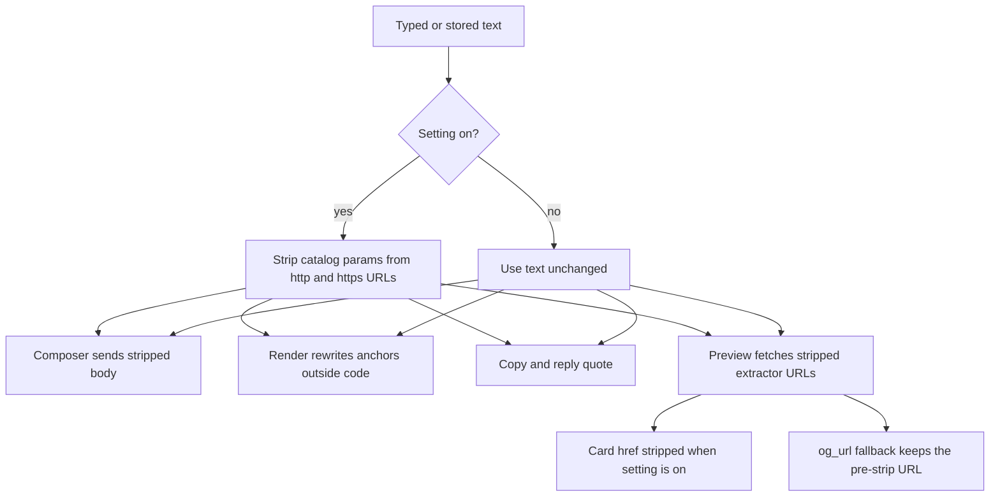

# Strip Tracking Markers - Plan

## Goal Capsule

- **Objective:** People can send and read links in Pacto without passing campaign and click identifiers through to the sites those links point at, and each account can turn that protection off.
- **Means:** A default-on, per-account setting strips a fixed catalog of tracking parameters at send time and again wherever a stored message is shown or fetched (KTD1, KTD4).
- **Authority:** Product Contract requirements win on behavior. Planning Contract decisions win on mechanism. GitHub issue 171 is the product source. This plan does not change whether web previews are fetched.
- **Stop conditions:** Do not rewrite stored inbound messages. Do not drop or blank a URL that failed to parse. Do not remove generic parameters (`ref`, `s`, `t`, `q`) on every host.
- **Execution profile:** Standard feature. Prove the pure stripper with unit tests before wiring call sites.
- **Ships:** The implementing agent opens the pull request. Merge stays with a maintainer.

## Product Contract

### Summary

Pacto gains a Privacy setting, Strip Tracking Markers, that removes known tracking parameters from links in messages. It is on by default, stored per account, and applies when a message is sent and when a received message is shown, copied, quoted, or previewed.

### Problem Frame

Shared links often carry campaign and click identifiers (`utm_*`, `gclid`, `fbclid`, and similar). Those values identify how the link was distributed and can follow the person who opens it. Pacto currently sends, renders, and previews those URLs unchanged, so the private messenger still forwards the tracker.

### Key Decisions

- **Default on.** The safe state is stripping. A default of off would leave every account leaking until someone finds the toggle. Governs R1.
- **Received messages stay stored as received.** Turning the setting off can restore those URLs only if the app did not rewrite them on disk. Messages this account already sent while the setting was on stay stripped, because that rewrite happened before send. Governs R4, R5, R6, R9.

### Requirements

- R1. Settings shows a Strip Tracking Markers checkbox that is enabled until the account turns it off, with helper text that says the app removes tracking markers from URLs before displaying or sending them, and that it should be disabled only when the person knows why.
- R2. The choice persists for the signed-in account across restart, logout, and login, and a different account on the same install keeps its own value.
- R3. While the setting is on, tracking parameters are removed from URLs in a composed message before that message is sent.
- R4. While the setting is on, rendered message links omit tracking parameters in both the address that opens and the visible text when that text is the URL.
- R5. While the setting is on, copying a message and quoting it in a reply preview omit tracking parameters from that text.
- R6. While the setting is on, the request that fetches a link preview, and the address the preview card opens, omit tracking parameters.
- R7. Non-tracking query parameters stay, in their original order and encoding, and a second pass over an already-clean URL changes nothing.
- R8. A string that is not an absolute `http` or `https` URL, or that cannot be parsed as one, is returned unchanged.
- R9. While the setting is off, compose, render, copy, reply quote, and preview use the stored or typed URL with no stripping.
- R10. The toggle label and description exist in the English and Spanish catalogs.

### Key Flows

- F1. Send a tracked link
  - **Trigger:** The person sends a message whose text contains an `http` or `https` URL with tracking parameters, and the setting is on.
  - **Steps:** The composer trims the body, strips tracking parameters from URLs in that text, then hands the result to the existing send callback.
  - **Outcome:** The stored and relayed body has the non-tracking parameters only.
  - **Covered by:** R3, R7, R8
- F2. Read a received link
  - **Trigger:** A message that still contains tracking parameters is rendered, and the setting is on.
  - **Steps:** Formatting rewrites link addresses and visible URL text outside code blocks. Copy and reply quote run the same text stripper on the plain body.
  - **Outcome:** The screen, the clipboard, and the quote omit tracking parameters. The stored row is unchanged, so turning the setting off shows the original text again.
  - **Covered by:** R4, R5, R9
- F3. Preview a link
  - **Trigger:** A message with an `https` URL becomes eligible for a web preview, and web previews are enabled.
  - **Steps:** The caller extracts `https` URLs the way `extract_https_urls` does, strips each one when the setting is on, and passes that list. The command fetches a candidate only when it is one of those stored URLs with nothing removed except query or fragment parameters. The card's open address is stripped at display time. An already completed fetch is not repeated when the toggle changes.
  - **Outcome:** The outbound preview request does not carry tracking parameters. The card does not open them either.
  - **Covered by:** R6, R9

### Acceptance Examples

- AE1. Send `https://example.com/a?utm_source=nl&id=1` with the setting on. The sent body is `https://example.com/a?id=1`. Covers R3, R7.
- AE2. Send that same text with the setting off. The sent body is unchanged. Covers R9.
- AE3. A received message `See https://example.com/a?fbclid=abc&id=1` renders an anchor whose address and visible text are `https://example.com/a?id=1` while the setting is on, and the original string while it is off. Covers R4, R9.
- AE4. `https://example.com/a?id=1&ok=2` is unchanged in every mode. Covers R7.
- AE5. `not a url` and `https://[bad` are unchanged. Covers R8.
- AE6. `https://youtu.be/abc?si=track` loses `si`. `https://example.com/a?si=1` keeps `si`. Covers R7 and the host rule in KTD3.
- AE8. A preview of `https://example.com/a?id=1'&utm_source=n` does not request `utm_source`. The `'` sits inside the span `extract_https_urls` returns and outside the render regex. Covers R6, KTD5.
- AE7. Account A saves the setting off. After logout and login as account B, B is still on. Logging back into A is still off. Covers R2.
- AE9. Account A sends `https://example.com/a?utm_source=n` while the setting is on, then turns the setting off. That sent message still has no `utm_source`. A received message that was stored with `utm_source` shows it again. Covers R9 and the second key decision.

### Scope Boundaries

In scope: the Privacy checkbox, per-account persistence, the parameter catalog in KTD3, and the message surfaces in F1–F3.

Out of scope:

- Changing whether web previews run at all.
- Rewriting historical inbound rows in SQLite or on relays.
- A user-edited parameter list.
- Unwrapping redirector URLs (`url` or `q` parameters that hide the real target), and stripping parameters that appear only on a later HTTP redirect or after the browser follows the opened link.
- GIF and sticker sends, which pass a provider URL around the composer.
- Message edit, which has a backend command and no frontend caller.
- Stripping links outside message text (profiles, wallet, announcements).

#### Deferred to Follow-Up Work

- Refetching a preview that was already fetched while the setting was off. Display stripping still applies to the card; the earlier request is not repeated.
- OS notification text. Rust builds those bodies from stored message content, and the catalog stays in the webview, so a banner can still show a tracking parameter.

### Sources

- Issue 171 acceptance criteria: default on, per-account persistence, strip on send and on render, leave other parameters, fail closed, English and Spanish, tests at the utility and both enforcement points.
- Privacy toggles today: `src/components/settings/PrivacySettingsSection.svelte`, `src/stores/typing-indicators.ts`, `src/stores/web-previews.ts`, loaded from `src/stores/persistence.ts` and cleared via `src/lib/utils/clear-account-state.ts`.
- Send finalizes in `src/components/dm/MessageInput.svelte` before `onSend` / `onSendMentions`.
- Render path: `src/lib/utils/message-formatting.ts` (`parseMarkdown` then private `linkify`, which skips existing anchors and code). `src/components/dm/FormattedMessageBody.svelte` is the caller.
- Preview fetch: `src/lib/messaging/link-preview.ts` calls `fetch_msg_metadata`, which reads stored content in `src-tauri/src/message.rs` and extracts `https` URLs in `src-tauri/src/util.rs`. `src/components/dm/LinkPreview.svelte` only displays `og_url` or `domain`.
- Copy uses the raw body via `src/components/dm/Message.svelte`. Reply quotes slice raw content in `src/lib/dm/resolve-dm-message-presentation.ts`, `src/components/channel/ChatView.svelte`, and `src/components/dm/DmThread.svelte`.
- Prior art for the catalog: Firefox `StripOnShare` lists, Brave query-filter and copy-clean-link notes, ClearURLs global rules. Those sources agree on a global click-id set plus host-scoped `si`, Instagram share ids, and X `ref_src` / `ref_url`. They also agree that `URLSearchParams` re-encoding changes surviving parameters.
- `docs/solutions/logic-errors/orphaned-relay-health-monitor-command.md`: a helper that is not called from every pipeline looks done and is not. Each surface in KTD4 needs its own test or a cited caller.

## Planning Contract

### Key Technical Decisions

- KTD1. Persist the boolean like send-typing-indicators: prefix `pacto_strip_tracking_markers_v1`, default `true`, and any corrupt or non-boolean stored value resolves to `true`. Web previews fail closed to `false` because turning them on leaks an IP address. Here the leak is leaving trackers in place, so a bad stored value must not disable the protection. Governs R1, R2.
- KTD2. One TypeScript function owns stripping. It walks the query by splitting on `&`, drops matching names, and rejoins the original slices. It does not run the survivors through `URLSearchParams`, which reorders keys and re-encodes `+` and percent-escapes. When KTD3 treats a fragment as form fields, that fragment uses this same slice splice, not `URL` or `URLSearchParams`. A name match is ASCII case-insensitive. The original key spelling of a kept parameter stays. Governs R7, R8.
- KTD3. The catalog is data in the stripper module, not scattered conditionals.
  - **Global prefix:** `utm_`. Bare `utm` is not a match.
  - **Global exact names:** `fbclid`, `gclid`, `dclid`, `gclsrc`, `gbraid`, `wbraid`, `msclkid`, `mc_eid`, `mc_cid`, `twclid`, `ttclid`, `yclid`, `srsltid`, `_ga`, `_gl`, `_openstat`, `wickedid`, `_hsenc`, `_hsmi`, `__hsfp`, `__hssc`, `__hstc`, `hsCtaTracking`, `mkt_tok`, `oly_anon_id`, `oly_enc_id`, `vero_id`, `vero_conv`.
  - **Host-scoped:** `si` on `youtube.com` (and subdomains), `youtu.be`, and `open.spotify.com`. `igsh` and `igshid` on `instagram.com` (and subdomains). `igshid` also on `threads.net` and `threads.com` (and subdomains). `ref_src`, `ref_url`, and `refsrc` on `x.com` and `twitter.com` (and subdomains).
  - **Host match:** lowercase hostname equals the rule, or ends with `.` plus the rule. `notyoutube.com` does not match `youtube.com`.
  - **Keep `mkt_tok`** when the URL path contains `unsubscribe`, compared case-insensitively. Other names in the catalog still drop.
  - **Never global:** `ref`, `referrer`, `referer`, `s`, `t`, `q`, `v`, `id`, and credential or signature names (`code`, `state`, `nonce`, `sig`, `signature`, `token`, `access_token`, `id_token`).
  - **Fragment:** if the fragment contains `=`, treat it as form fields and drop the same names. Leave `#section` and `#/route` alone. Never delete the whole fragment.
  - The issue listed `igshid` and `ref_src` next to global ids and only called `si` host-specific. Global rules for those names are not what Firefox, Brave, or ClearURLs ship, and a global `si` would strip a functional parameter on unrelated sites. Host scope is the challenge outcome. Governs R3, R4, R7.
- KTD4. Apply the stripper at the surfaces that actually emit or show the URL, and nowhere else. Inbound SQLite and relay bytes stay raw.
  - Composer submit, after trim and before the send callbacks.
  - HTML produced for the message body, after markdown and linkify, skipping anchors' inner content that sits inside `code` or `pre`. Markdown already turns bare URLs into anchors, and linkify skips those anchors, so a rewrite that only edits linkify's bare-URL callback misses the common case.
  - Copy, on the plain body, at the menu handler that already holds that text.
  - Reply quotes, via one helper that strips then slices, at four sites. The DM bubble slices `replied_to_content`. The channel bubble slices the parsed body of `replied_to_content`, not the raw structured string. Both composer chips (`ChatView.svelte` `onReply` and `DmThread.svelte` `onReply`) slice raw `content`. Do not strip the channel bubble's raw `replied_to_content` before `parseMessageContent`.
  - Preview fetch: per KTD5. The text walker is not the input to that fetch.
  - Preview card: strip the existing open address (`og_url`, else `domain`) when the setting is on. The click handler opens that same value.
  - `FormattedMessageBody` and `LinkPreview` read the store inside the derived value that builds the HTML or the href, so a toggle updates an open thread. Governs R3, R4, R5, R6, R9.
- KTD5. The preview GET uses the one TypeScript stripper on the URL strings `extract_https_urls` returns, not a stripped copy of the whole message. `extract_https_urls` keeps characters the render regex stops on, including `'`, so a stripped prose copy can still be fetched with a catalog parameter. Rejected: a second Rust copy of KTD2, and a prose override that the Rust scanner tokenizes again. The command takes the URL list from its one frontend caller on every call. Setting on passes each extracted URL through the stripper. Setting off passes the same URLs unstripped, on purpose, so R9 is not an omitted argument. `null` or an empty list fetches nothing and does not fall back to the stored body. Before fetching, the command keeps a candidate only when it has no userinfo and its scheme, hostname, port, and path equal a stored extracted URL, and every remaining query or fragment pair is one of that stored URL's pairs with the same value. Anything else is dropped. `fetch_site_metadata` writes the request URL into `og_url` when the page has no `og:url`. For a stripped fetch, persist the pre-strip stored URL in that fallback instead, so display-time stripping can still hide it and toggle-off can show it. The message body stays raw. Governs R6, R9.

### High-Level Technical Design

The setting is a Svelte store. Send, copy, and fetch read it at the moment of the action. Render, the preview card, and reply-quote bubbles read it during derivation so a toggle updates them. A composer reply chip is derived from the reply target and the store, not frozen at the click that started the reply. Inbound message bodies are not rewritten. The preview row's `og_url` fallback is the exception in KTD5: it stores the pre-strip URL while the GET uses the stripped one.

### Assumptions

- The extra global names beyond the issue's examples (`twclid`, `_ga`, HubSpot, Marketo, and the rest of the KTD3 exact list) belong in the catalog. They are the share-cleaning set Firefox and ClearURLs already ship, and they are click or email identifiers rather than page parameters.
- Plain-text paths strip every `http` and `https` URL in the string, including ones the author put in a markdown code fence. The rendered bubble does not. Recorded under Deferred to Follow-Up Work for the fence case; the send path still strips because R3 covers the composed body as sent.
- A preview that already completed is not fetched again when the toggle flips. The card address still follows the setting.
- GIF and sticker URLs are out of scope, as are surfaces outside message text.
- `mkt_tok` on an unsubscribe path is functional and must survive.

### Sequencing

U1 has no dependencies. U2 depends on nothing in U1 but ships the store the later units read. U3 and U4 depend on U1 and U2. U3 and U4 touch different files and can land as separate commits.

## Implementation Units

### U1. Tracking-parameter stripper

**Goal:** A pure function removes the KTD3 catalog from a single URL and from URLs inside a text blob, and leaves everything else byte-for-byte.

**Requirements:** R7, R8, and the catalog in KTD3.

**Dependencies:** None.

**Files:**

- `src/lib/utils/url-tracking.ts` (new)
- `src/lib/utils/url-tracking.test.ts` (new)

**Approach:**

- Export the catalog as data (prefix list, exact-name set, host rules) and two functions: one URL in, one URL out; one text blob in, one text blob out.
- Parse with `URL` only to decide that the candidate is absolute `http` or `https` and to read hostname and path. Build the returned string by editing the original query and, when KTD3 says so, the fragment. On any parse failure, return the input unchanged.
- The text walker owns the URL boundary. `message-formatting.ts` uses that export for linkify so the two cannot drift. Trailing punctuation stays outside the URL.
- Preview URLs are a second extractor, used only to build the fetch list. It follows `extract_https_urls`: `https://` only, end on whitespace or `" < > ) ] } |`, then trim trailing `. , : ;`. It does not use the render regex, which stops on `'`.
- Drop a dangling `?` when the query becomes empty. Remove every duplicate of a matching name, including an empty value.

**Patterns to follow:** `new URL` try/catch in `src/lib/api/relays.ts`. Vitest node environment, co-located tests.

**Test scenarios:**

- `https://example.com/a?utm_source=nl&id=1` becomes `https://example.com/a?id=1`.
- `https://example.com/a?id=1&UTM_MEDIUM=x&ok=2` becomes `https://example.com/a?id=1&ok=2` with `id` and `ok` still in that order and spelling.
- `https://example.com/a?fbclid=abc` becomes `https://example.com/a` with no trailing `?`.
- A second call on the stripped result returns the same string.
- `https://example.com/a?id=1&ok=2%7E` keeps `ok=2%7E` unchanged.
- `https://example.com/a?q=hello+world&gclid=1` keeps `q=hello+world`.
- `https://youtu.be/abc?si=track` drops `si`. `https://example.com/a?si=1` keeps `si`. `https://music.youtube.com/watch?v=1&si=track` drops `si` and keeps `v=1`. `https://notyoutube.com/a?si=1` keeps `si`.
- `https://www.instagram.com/p/1/?igshid=abc` drops `igshid`. `https://example.com/?igshid=abc` keeps it.
- `https://x.com/a?ref_src=tw&id=1` drops `ref_src` and keeps `id`. `https://example.com/a?ref_src=tw` keeps `ref_src`.
- `https://news.example/unsubscribe?mkt_tok=abc&utm_source=n` keeps `mkt_tok` and drops `utm_source`. `https://news.example/unsub?mkt_tok=abc` drops `mkt_tok`.
- `https://example.com/a?id=1#utm_source=n&x=1` becomes `https://example.com/a?id=1#x=1`. `https://example.com/a#section` stays. `https://example.com/a#/route` stays.
- `mailto:a@b.com?utm_source=n` is unchanged. `https://[bad` is unchanged. `see https://example.com?utm_source=n.` becomes `see https://example.com.` with the period still outside the URL.
- Text with no URL is unchanged, including the empty string.
- The preview extractor returns `https://example.com/a?id=1'&utm_source=n` as one URL. The single-URL stripper then drops `utm_source` and keeps the `'` with `id`.

**Verification:** `src/lib/utils/url-tracking.test.ts` passes and covers each scenario above.

### U2. Per-account setting

**Goal:** The signed-in account can see and change the setting, and the value follows that account.

**Requirements:** R1, R2, R10. Mechanism is KTD1.

**Dependencies:** None. Land before U3 and U4.

**Files:**

- `src/stores/strip-tracking-markers.ts` (new)
- `src/stores/strip-tracking-markers.test.ts` (new)
- `src/stores/persistence.ts`
- `src/lib/utils/clear-account-state.ts`
- `src/components/settings/PrivacySettingsSection.svelte`
- `src/lib/i18n/locales/en/settings.json`
- `src/lib/i18n/locales/es/settings.json`

**Approach:**

- Mirror `src/stores/typing-indicators.ts`: exported prefix, writable boolean named `stripTrackingMarkersEnabled` defaulting to `true`, subscribe-to-persist, `loadStripTrackingMarkersPreference(npub)` that sets the persistence npub and then reads. Missing key, non-boolean JSON, and parse failure all set `true`.
- Call the loader from `loadAccountState` next to the typing-indicator loader. Do not add the prefix to `SCOPED_KEY_PREFIXES`. That list deletes the key on logout, which would break R2. On logout, after the persistence npub is cleared, set the in-memory store back to `true`. The subscribe writes nothing while the npub is null, so account A's key stays on disk.
- Add the checkbox in `PrivacySettingsSection.svelte` directly under the typing-indicator toggle, using the same label-plus-description markup. `checked` reads `$stripTrackingMarkersEnabled`. `onchange` writes the store with `set`. Do not use `bind:checked`.
- English label: `Strip Tracking Markers`. English description: `When enabled, Pacto will automatically remove tracking markers from URLs before displaying or sending them. This helps reduce your footprint and enhances your privacy with no loss in functionality — only disable if you know what you're doing.`
- Spanish label: `Quitar marcadores de seguimiento`. Spanish description: `Si está activado, Pacto quita automáticamente los marcadores de seguimiento de las URLs antes de mostrarlas o enviarlas. Así reduces tu huella y mejoras tu privacidad sin perder funcionalidad. Desactívalo solo si sabes lo que haces.`
- Keys: `settings.stripTrackingMarkersLabel` and `settings.stripTrackingMarkersDescription` in both catalogs. No hardcoded user-facing English in the component.

**Patterns to follow:** `src/stores/typing-indicators.ts` and its test. The checkbox block in `PrivacySettingsSection.svelte`.

**Test scenarios:**

- With no stored value, the store is `true` after load for an npub.
- Setting the store to `false` writes a JSON boolean under `pacto_strip_tracking_markers_v1_<npub>` and does not write a key for a different npub.
- Loading that npub again restores `false`. Loading a second npub with no key restores `true`.
- Stored values `null`, `"false"`, `0`, and truncated JSON each load as `true`.
- With no current npub, a store write does not call `localStorage.setItem`.
- Saving `false`, then running the logout clear for that npub, leaves the localStorage key in place and leaves the in-memory store `true`. Loading that npub again restores `false`.

**Verification:** The store test passes. Both locale files contain the two keys. The Privacy section renders the new checkbox bound to the store.

### U3. Send, copy, and reply quote

**Goal:** Plain-text message surfaces use the stripper when the setting is on and the original text when it is off.

**Requirements:** R3, R5, R9. Surfaces named in KTD4.

**Dependencies:** U1, U2.

**Files:**

- `src/components/dm/MessageInput.svelte`
- `src/components/dm/MessageInput.test.ts`
- `src/components/dm/Message.svelte`
- `src/components/dm/Message.test.ts`
- `src/lib/dm/resolve-dm-message-presentation.ts`
- `src/lib/dm/resolve-dm-message-presentation.test.ts`
- `src/components/channel/ChatView.svelte`
- `src/components/dm/DmThread.svelte`

**Approach:**

- In `handleSubmit`, after trim produces a non-empty body and before the `onSend` / `onSendMentions` branch, replace the body with the text stripper result when the store is on. Mention pruning and both callbacks then see that body. Channel send uses `onSendMentions`.
- In `Message.svelte` `handleMenuCopy`, strip the body when the store is on, then pass that string to `onCopy`. The menu and the DM and channel clipboard writers stay as they are.
- Reply quotes call one helper that strips, then slices to 80 characters, and only strips when the store is on. Bubble quotes and composer chips read the store while they are derived, so turning the setting off restores the stored text in the quote. Do not snapshot the chip once inside `onReply`. Call the helper from the four sites in KTD4. `ChatView.svelte` and `DmThread.svelte` stay legacy shells; the change is the helper call, not a runes conversion.
- Do not strip GIF or sticker sends.

**Patterns to follow:** `get(store)` at action time, as `requestLinkPreview` already does for web previews. Existing `MessageInput` send test.

**Test scenarios:**

- Enter on a composer whose text is `https://example.com/a?utm_source=nl&id=1` and whose store is `true` calls `onSend` with `https://example.com/a?id=1`.
- The same submit with `onSendMentions` provided calls that callback with the stripped body, not `onSend`.
- The same text with the store `false` calls `onSend` with the original string.
- A body with no URL is sent unchanged when the store is `true`.
- `https://[bad` is sent unchanged when the store is `true`.
- The DM reply-preview helper, given content `https://example.com/a?fbclid=abc&id=1` and the store `true`, produces a preview that contains `id=1` and does not contain `fbclid`. With the store `false`, the preview contains `fbclid`.
- `Message.test.ts`: invoking the copy path with the store `true` hands the parent a string that has no tracking parameter; with the store `false`, the parent receives the original text.

**Verification:** `MessageInput.test.ts`, `Message.test.ts`, and `resolve-dm-message-presentation.test.ts` pass, including the new cases. A grep shows the text stripper or the quote helper called from `MessageInput.svelte`, `Message.svelte` `handleMenuCopy`, `resolve-dm-message-presentation.ts`, both quote sites in `ChatView.svelte`, and `DmThread.svelte`.

### U4. Rendered links and link previews

**Goal:** Opened links and preview fetches follow the setting without rewriting stored messages.

**Requirements:** R4, R6, R9. Mechanism is KTD4 and KTD5.

**Dependencies:** U1, U2.

**Files:**

- `src/lib/utils/message-formatting.ts`
- `src/lib/utils/message-formatting.test.ts`
- `src/components/dm/FormattedMessageBody.svelte`
- `src/components/dm/LinkPreview.svelte`
- `src/components/dm/LinkPreview.test.ts`
- `src/lib/messaging/link-preview.ts`
- `src/lib/messaging/link-preview.test.ts`
- `src/lib/api/nostr.ts`
- `src-tauri/src/message.rs`

**Approach:**

- Add a boolean argument to `formatMessageContent` and `formatMessageContentWithMentions`. `FormattedMessageBody` passes `$stripTrackingMarkersEnabled` from inside `$derived.by`, alongside the existing libs epoch, so a toggle re-renders. Channel bubbles use the mentions formatter, so both functions honor the flag.
- After linkify and before sanitize, rewrite `http` and `https` hrefs that are outside `code` and `pre`. Do not reuse the linkify skip set; that set also skips existing anchors, which is the case this rewrite exists to catch. If the anchor's own text is that same URL, rewrite the text too. Leave link text that is not the URL (`[label](url)`) alone. Leave code blocks alone. Escape the rewritten href the same way linkify escapes today, so a surviving `&` stays an attribute separator.
- `LinkPreview` runs the URL stripper on its existing open-address value when the store is on, and uses that raw value when it is off. Read the store in that derived. The click handler opens the derived value.
- `requestLinkPreview` builds the fetch list with the preview extractor from U1. Setting on: each URL is stripped. Setting off: the same URLs are passed unstripped. It always passes the list. Web previews off still skips the invoke.
- `fetchMsgMetadata` takes that list. The Rust command requires it. A pure helper, testable without the chat-state lock, keeps a candidate only under the KTD5 rule and chooses the `og_url` fallback. `null` and an empty list yield no fetch.
- Do not clear the preview request dedupe when the toggle changes.

**Patterns to follow:** Walking tags in `message-formatting.ts` to know when the cursor is inside `code` or `pre`. `webPreviewsEnabled` gating in `requestLinkPreview`. Command arguments on `fetch_msg_metadata`, not a field of the metadata struct.

**Test scenarios:**

- With stripping on, `formatMessageContent('https://example.com/a?utm_campaign=x&id=1')` returns HTML whose href and visible text are `https://example.com/a?id=1` and do not contain `utm_campaign`.
- With stripping on, `https://example.com/a?id=1&ok=2` renders an href that still contains both parameters, with `&` escaped as `&amp;`.
- With stripping off, `https://example.com/a?utm_campaign=x&id=1` keeps `utm_campaign` in the href.
- `formatMessageContentWithMentions` applies the same href rewrite when stripping is on.
- With stripping on, markdown `[docs](https://example.com/a?gclid=1)` keeps visible text `docs` and its href has no `gclid`.
- With stripping on, a fenced code block whose body is `https://example.com?utm_source=n` still contains `utm_source` in the output.
- `LinkPreview` with `og_url` `https://example.com/a?fbclid=abc` and the store on renders an anchor whose href has no `fbclid`. With the store off, the href contains `fbclid`.
- `requestLinkPreview` with the store on invokes `fetch_msg_metadata` with a list whose `https://example.com/a?id=1'&utm_source=n` entry has no `utm_source`. With the store off, that list entry still contains `utm_source`. With web previews off, it does not invoke.
- The Rust helper drops `https://evil.example/a`, drops `https://example.com:444/a?id=1` and `https://user@example.com/a?id=1` when the stored URL is `https://example.com/a?id=1&utm_source=n`, and keeps `https://example.com/a?id=1` for that stored URL. It also keeps an equal unstripped URL. An empty list and a null list yield no URLs. When the kept fetch URL differs from the stored URL, the `og_url` fallback is the stored URL.

**Verification:** The formatting, LinkPreview, and link-preview tests pass. The Rust helper test passes. Toggling the store changes a rendered href without a reload, because `FormattedMessageBody` reads the store inside the derived HTML.

## System-Wide Impact

- Outbound DM and channel text is stripped only in the composer. Programmatic `sendDmMessage` callers (join inbox, admissions, and similar) do not pass through that composer and stay unstripped. Those bodies are app-generated, not pasted links.
- Inbound rows and relay payloads are unchanged. Other clients and a later toggle-off on this client still see the original received text.
- Preview HTTP, including the Tor-aware client, requests the stripped URL when the setting is on. The preview image and favicon URLs are whatever the fetched page declared; this plan does not strip those asset URLs.
- A new localStorage prefix joins the account-scoped clear list. No SQLite migration.
- `fetch_msg_metadata` requires the URL list from `fetchMsgMetadata`, its only frontend caller. A candidate that is not a stored `https` URL with only query or fragment parameters removed is not fetched. A missing list does not mean "use the raw body."

## Risks & Dependencies

- **Composer tests replace `URL`.** The send test must use a real `URL` parser for the strip assertion, or the stripper's fail-closed path will hide a working implementation. Mitigation: keep the GIF tests' stub local to those cases, and assert a stripped `onSend` payload in the new case.
- **Host suffix false positive.** `notyoutube.com` must not match `youtube.com`. Mitigation: the dot-boundary rule in KTD3, with AE6 and the U1 cases.
- **Markdown versus linkify.** Stripping only inside linkify misses anchors marked already created. Mitigation: the post-linkify rewrite in U4, with a test that does not depend on linkify being the tag author.
- **A caller-supplied preview URL could point somewhere else.** Mitigation: KTD5 keeps a candidate only when scheme, host, and path match a stored extraction and the only difference is removed query or fragment parameters. The U4 helper test covers a foreign host.
- **Surviving parameters get re-encoded.** Mitigation: KTD2 and the U1 percent-encoding and `+` cases.
- **A call site is forgotten.** Mitigation: the caller grep in U3 verification, and a test on each of send, render, and preview fetch.

## Verification Contract

- `pnpm exec vitest run src/lib/utils/url-tracking.test.ts src/stores/strip-tracking-markers.test.ts src/components/dm/MessageInput.test.ts src/components/dm/Message.test.ts src/lib/dm/resolve-dm-message-presentation.test.ts src/lib/utils/message-formatting.test.ts src/components/dm/LinkPreview.test.ts src/lib/messaging/link-preview.test.ts`
- `pnpm check`
- `pnpm lint`
- `cd src-tauri && cargo test --lib` for the preview URL-candidate helper. Narrow the filter to that test's module once it exists; do not leave the helper untested.

## Definition of Done

- R1–R10 hold, including AE1–AE9.
- U1–U4 verification outcomes passed.
- The diff contains no tracker ids, no spec-section markers, and no second parameter catalog in Rust.
- Abandoned experiments are not left in the diff.
- English and Spanish label and description keys are both present and used by the Privacy checkbox.
