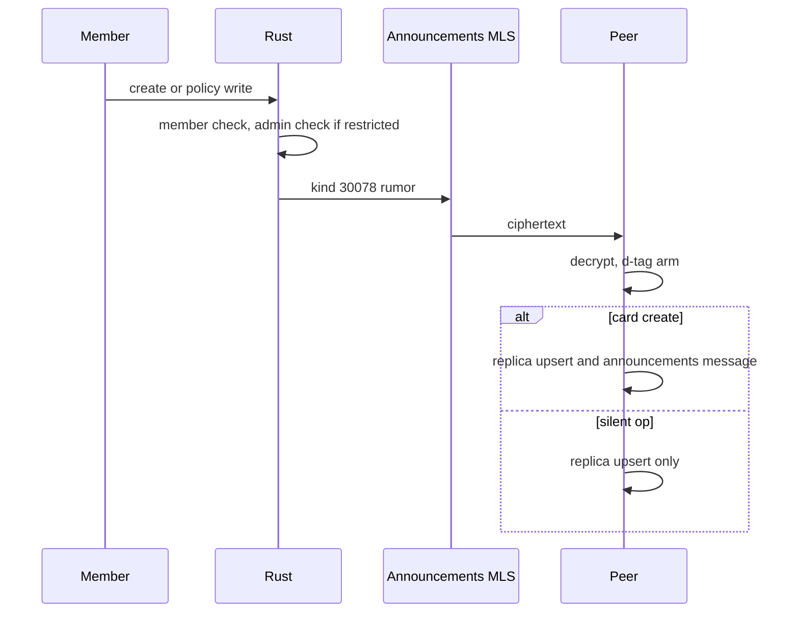

# Squad Group Records and Add Restrictions - Plan

## Goal Capsule

- **Objective:** Squad members share events and doc links inside the encrypted announcements group, and a squad can optionally limit who adds each, without a relay or a chain role learning the contents.
- **Means:** Kind 30078 rumors with their own `d` tags, copied from dashboard polls, plus one content-policy rumor with two independent flags (KTD1, KTD4).
- **Authority:** Approved Squad Events and Squad Docs Shelf requirements (2026-11-03). This plan owns the shared transport and the restrict setting. Feature behavior stays in the events and docs plans.
- **Stop:** Do not put either flag on `GovCapability`. Do not send raw NIP-52 kinds as the MLS rumor kind. Do not build on pull request 431.
- **Execution:** Code. Land this plan before the events plan and the docs plan. Product Contract carried forward from those requirements; planning did not change who may add by default.
- **Finishes:** An implementer ships the policy rumor, the settings control, and the ingest rules. The feature plans ship their own records on top.

## Product Contract

### Summary

Events and doc links both need the same pipe polls already use: an encrypted rumor in the parent announcements MLS group, a per-device SQLite replica, and a virtual channel that is not a second chat. Both also need an optional "only some people can add" switch that stays off until a squad turns it on. Those two switches are separate. One shared rumor carries both so the mechanism exists once.

Product Contract unchanged in meaning. The requirements left the pipe and the permission slot for planning; this file is that slot.

### Problem Frame

Polls already prove the pipe. `send_dashboard_poll_create` writes a kind 30078 rumor with `d` = `pacto_dashboard_poll` into the announcements group. `process_rumor` in `src-tauri/src/rumor.rs` has an arm only for that `d` tag. Any other 30078 falls through `process_app_specific` and returns `Ignored`, which `src-tauri/src/mls.rs` does not store. Kinds 31922, 31923, and 31925 hit `process_unknown_event` and become a stored unknown event, not a card and not a replica row.

The chain permission list cannot host the switch. `GovCapability` in `src-tauri/src/evm/access_control/capability.rs` is a signing preflight. An empty roster address denies every capability, so "any member by default" would be false for anyone who has not linked an EVM address. `#settings` squad mode renders `DashboardSettingsTab` for every member. Nothing there is a content ACL.

### Key Decisions

- **Records ride the announcements MLS group, the same way polls do.** Relays see ciphertext. (session-settled: user-directed — chosen over a NIP-29 relay group and over a public event: a relay that manages the group would see the payload). Governs R1, R2.
- **Any member can add until the squad turns a restriction on.** (session-settled: user-directed — chosen over admin-only as the default: the owner set the default to open). Governs R4, R5.
- **Events and docs keep separate switches.** Planning recommendation. One combined switch would block docs because the squad restricted events. Governs R5.

### Requirements

**Transport**

- R1. A squad record is an encrypted kind 30078 rumor in the parent `#announcements` MLS group. The `d` tag names the record type. The JSON body is readable only after MLS decrypt.
- R2. A create that should appear in `#announcements` is one rumor, and that rumor is the card. An update, a response, a cancel, or a remove writes the replica and adds no timeline row. A weekly series is eight silent event creates plus one series card rumor, specified in the events plan.

**Authority**

- R3. The latest authorized write for a record id wins. An update, cancel, or remove is ignored unless the signer is the record author or a squad admin. A response, such as an RSVP, is kept when the signer is a current member and is the response author.
- R4. With the matching restriction off, any current member of the announcements group can add that record type.
- R5. A squad can turn on event-create restriction and doc-add restriction independently. While a restriction is on, only a squad admin can add that record type. Other members' adds are ignored.

**Settings**

- R6. The two switches live on the squad settings surface. A member who is not an admin does not get a control that looks like it saved.

### Actors

- A1. Member — adds a record while the matching restriction is off.
- A2. Squad admin — turns a restriction on or off, and adds while it is on.
- A3. Non-member — never decrypts the rumor.

### Key Flows

- F1. Add while open
  - **Trigger:** A1 submits a create and the matching restriction is off.
  - **Steps:** The client sends one 30078 rumor. Peers ingest it into the replica. A card rumor also appears in `#announcements`.
  - **Outcome:** Both members see the replica row.
- F2. Restrict, then add
  - **Trigger:** A2 turns the matching restriction on. A1 then submits a create.
  - **Steps:** Peers store the policy. They drop A1's create.
  - **Outcome:** The replica does not gain A1's row. A2 can still add.

### Acceptance Examples

- AE1. Two members, restriction off. A1 adds. A2's replica shows the row. A relay capture of the wrapping kind 444 event contains ciphertext only.
- AE2. Restriction on. A1's create is absent on A2. A2, as admin, adds, and A1's replica shows that row.
- AE3. A1 edits A2's record. Every client keeps A2's last authorized body.

### Success Criteria

- A relay log of the send shows MLS ciphertext only.
- Turning on one restriction leaves the other at its previous value.
- A client that is not a member of the announcements group has no replica row.

### Scope Boundaries

**Deferred for later**

- Issues 473, 474, and 475 (calendar export, closed-app push, public events).
- Issues 476, 477, and 478 (link previews, native notes, provider OAuth).
- Republishing the current replica to someone who joined after the rumor was sent. Late joiners miss earlier MLS history, as they already do for polls.

**Outside this product's identity**

- NIP-29 groups, NIP-51 private lists, and chain hats as the default add check.

**Deferred to Follow-Up Work**

- Teaching an old binary to replay a 30078 rumor it already returned as `Ignored`. Pre-alpha clients ship the new arm before anyone relies on the records.

### Open Questions

- Q1. Who is the squad admin for R3 and R5? **Recommendation:** the current `admin_pubkeys` set on the announcements MLS group, which today is the creator key from `create_group`. Hats captain and squad-admin FULL are a different set, and they are missing on a squad that has never deployed governance. Proceed with `admin_pubkeys` (A1). The owner should overturn this only if "squad admin" must mean the hat even when that hat does not exist.

### Sources

- Approved requirements: Squad Events MVP and Local Reminders, Squad Docs Shelf (Notion, approved 2026-11-03).
- `docs/dashboard/POLLS.md`, `src-tauri/src/dashboard_poll.rs`, `src-tauri/src/rumor.rs`.
- `src-tauri/src/evm/access_control/capability.rs`, `src/components/parent/dashboard/DashboardSettingsTab.svelte`.
- `src-tauri/src/mls.rs` group create sets `admins` to the creator. Content ingest uses `is_author_mls_member_for_chat` in `src-tauri/src/db/squad.rs`, which is membership, not admin.
- NIP-52 (nostr-protocol nips, draft): kinds 31922, 31923, 31925. Field names are used inside the events payload. The rumor kind stays 30078 because this ingest path does not render those kinds.

## Planning Contract

### Key Technical Decisions

- KTD1. **Each record type is kind 30078 with its own `d` tag, and `process_rumor` grows an arm per tag.** A raw kind 31922, 31923, or 31925 is stored as `UnknownEvent` and never becomes a card. An unknown 30078 is `Ignored` and dropped. Kind 14 JSON would render as a chat bubble and is eligible for link preview. Poll create is the card path to copy. Poll vote (`DashboardPollVoteIngested`) is the silent path to copy. Bake-off did not apply: the ingest match already eliminates raw NIP-52 kinds, so the remaining choice is judgment against code that is already here.
- KTD2. **Last authorized `updated_at` wins, per record, sticker-style.** Poll create is first-create-wins (`IgnoredConflictingPayload`). Do not copy that for edits. A child rumor that arrives before its parent is kept and applied when the parent lands. Applying a queued update, cancel, or remove checks author-or-admin against the stored author. A queued response checks that the signer is a member. Equal timestamps keep the row already stored. The send command stamps `updated_at_ms` from the backend clock and ignores a client-supplied stamp.
- KTD3. **Authorize against announcements-group membership, and against `admin_pubkeys` when the action needs an admin.** `require_capability` stays on chain signing. The settings tab hides the switches unless the signed-in member is in `admin_pubkeys`. Peers ignore a policy rumor whose author is not in that set. See Q1.
- KTD4. **One silent policy rumor carries two flags, each with its own timestamp.** `d` = `pacto_squad_content_policy`, schema `pacto.squad_content_policy.v1`. Absent row means both restrictions off. Applying an older timestamp for one flag must not rewrite the other flag. The backend stamps the flag that changed. The other flag keeps the timestamp the sender last stored. A non-admin create is stored only while that flag is off. When a restrict-on flag is applied, drop non-admin rows of that type whose `updated_at_ms` is at or after the flag timestamp, including a row the sender inserted locally. Turning the flag off does not restore dropped rows.
- KTD5. **The switches render in squad settings, beside privileges, as their own section.** `SquadPrivilegesSection` is the chain role card. The permissions catalog in `src/lib/dashboard/permissions-panel.ts` is explanatory copy. Neither becomes a toggle list.

### High-Level Technical Design



Policy apply, directional:

```text
if author is not in admin_pubkeys:
  store nothing
else for each flag:
  if incoming.updated_at_ms > stored.updated_at_ms:
    store that flag only
```

### Assumptions

- A1. Q1 stays on `admin_pubkeys` until the owner says the hat. If that set contains no current member, restriction-on means nobody can add, and the settings copy says why. The switch stays hidden for non-admins, so they cannot turn it back off.
- A2. A build that already returned `Ignored` for these `d` tags will not grow a replica row on upgrade. Ship the arm before use. No dual-read of a second encoding.
- A3. "Squad admin" in the feature plans means this plan's admin check. They do not invent a second list.

### Sequencing

This plan lands first. The events plan and the docs plan both depend on U1 and U2. They can proceed in parallel after that. U3 can land with U2.

### Effort

| Unit | Engineer-days |
| --- | --- |
| U1. Admin check | 1.0 |
| U2. Policy rumor and ingest | 2.0 |
| U3. Settings section | 1.0 |
| U4. Routing note | 0.5 |
| **Total** | **4.5** |

### System-Wide Impact

- `process_rumor`, and the match arms in `src-tauri/src/mls.rs` and `src-tauri/src/cmds/relays.rs`, gain one silent result for the policy rumor. The events and docs plans add their own arms in those same matches. Land this plan first so those edits stay additive.
- `DashboardSettingsTab` gains a section. Squad mode already mounts that tab for every member. Hiding the switches is not the authorization check. U2 ingest is.
- No new virtual-bucket value. A policy rumor that is stored as a chat message would show up in `#announcements`. U2's tests forbid that row.
- `GovCapability`, chain signing, and the permissions catalog stay as they are.

### Risks

- **Creator key left the squad.** `admin_pubkeys` is not updated when membership changes. Restriction-on can leave nobody able to add. A1 states the copy. Changing the set is out of scope.
- **Stale settings screen.** A save must send the flag the member changed plus the timestamp they last stored for the other flag. KTD4 keeps a stale sibling from winning.
- **Forged admin rumor.** MLS will carry any member's ciphertext. Ingest is the check that matters. The UI hide is not the check.

## Implementation Units

### U1. Admin check

- **Goal:** One helper answers "is this npub a current member?" and "is this npub in `admin_pubkeys`?" for the announcements group.
- **Requirements:** R3, R4, R5. KTD3.
- **Dependencies:** None.
- **Files:** `src-tauri/src/db/squad.rs` (extend next to `is_author_mls_member_for_chat`), `src-tauri/src/mls.rs` (read `admin_pubkeys` the way leave commits already do), `src-tauri/src/db/squad.rs` tests or the existing squad test module.
- **Approach:** Membership stays the participant list, fail closed when the list cannot be read. Admin is the engine group's `admin_pubkeys` for that MLS group id, compared as npub. Do not cache the set in a second table.
- **Patterns to follow:** `is_author_mls_member_for_chat`. Leave-commit admin read in `src-tauri/src/mls.rs`.
- **Test scenarios:**
  - Member npub in `participants` returns member, not admin.
  - Creator npub in `admin_pubkeys` returns admin.
  - Empty participant list returns not a member.
  - A npub that is admin in a different group returns not admin for this group.
- **Verification:** The helper tests pass without a chain call and without `GovCapability`.

### U2. Policy rumor and ingest

- **Goal:** Admins can publish the two flags, and every client enforces them on later adds.
- **Requirements:** R1, R2, R4, R5. KTD1, KTD2, KTD4.
- **Dependencies:** U1.
- **Files:** `src-tauri/src/squad_content_policy.rs` (new), `src-tauri/src/rumor.rs`, `src-tauri/src/mls.rs`, `src-tauri/src/cmds/relays.rs`, `src-tauri/src/lib.rs`, new migration via `make new-migration name=squad_content_policy`, `src/lib/api/squad-content-policy.ts` (new, and called from U3).
- **Approach:**
  - Rumor kind 30078, `d` = `pacto_squad_content_policy`, no timeline message.
  - Table keyed by parent id. Columns for each flag's value and its `updated_at_ms`, plus author npub of the write that last changed that flag.
  - Send command checks U1 admin. Ingest ignores non-admin authors and older timestamps per flag.
  - Register the command in `generate_handler!` and call it from the settings section. An uncalled command is a dead feature (`docs/solutions/logic-errors/orphaned-relay-health-monitor-command.md`).
- **Patterns to follow:** `dashboard_poll.rs` send plus ingest. Sticker `updated_at` upsert in `maybe_upsert_sticker_pack_from_announce`. `DashboardPollVoteIngested` for "no message".
- **Test scenarios:**
  - Admin publish with both flags false inserts a row. No `events` timeline row is written.
  - A newer `restrict_doc_add` timestamp changes docs only and leaves the event flag and its timestamp.
  - An older timestamp for either flag leaves the stored flag.
  - A member who is not admin: send is rejected, and a rumor that still arrives is ignored.
  - Missing policy row is treated as both flags off by the lookup the feature plans will call.
  - Applying restrict-on returns a drop set: non-admin rows of that type whose `updated_at_ms` is at or after the flag timestamp, including a row this client inserted locally. Turning the flag off does not put those rows back.
- **Verification:** `cargo test` covers the module. `pnpm check:tauri-commands` stays clean because the wrapper is referenced from U3.

### U3. Settings section

- **Goal:** An admin sees two switches on squad settings and a non-admin does not.
- **Requirements:** R6. KTD5. A1.
- **Dependencies:** U2.
- **Files:** `src/components/parent/dashboard/SquadContentPolicySection.svelte` (new, runes), `src/components/parent/dashboard/DashboardSettingsTab.svelte`, `src/lib/i18n/locales/en/governance.json`, `src/lib/i18n/locales/es/governance.json`, a vitest file next to the section's pure helper if the helper is extracted, otherwise `src/lib/api/squad-content-policy.test.ts`.
- **Approach:** Mount the section from `DashboardSettingsTab` under squad mode. Load the policy with the new command. Hide the controls when the caller is not admin. If restriction is on and no current member is admin, show the explanatory line from A1 and no switch. Copy is i18n in both catalogs. Do not convert `DashboardSettingsTab` or `SquadSettingsView` to runes.
- **Patterns to follow:** `SquadStickersSection.svelte` for an MLS-backed settings block. `persistence` is not used; the replica is the source.
- **Test scenarios:**
  - Render helper: admin sees two switches, non-admin sees none.
  - Toggling docs sends a payload whose event timestamp is the stored one, not "now", when the event flag did not change.
  - Empty policy renders both switches off for an admin.
- **Verification:** `pnpm test` covers the helper. Both locale files contain the new keys (`src/lib/i18n/messages.test.ts`).

### U4. Routing note

- **Goal:** The virtual-channel ADR states that these silent rumors are not new timeline buckets.
- **Requirements:** R2. KTD1.
- **Dependencies:** U2.
- **Files:** `docs/mls/VIRTUAL_CHANNEL_ROUTING_ADR.md`, `docs/dashboard/POLLS.md` (one paragraph pointing here).
- **Approach:** Document the `d` tags `pacto_squad_content_policy`, and reserve the names `pacto_squad_event` and `pacto_squad_doc` for the feature plans. State that silent ops must use the vote-style result and must not add `events` or `docs` to the bucket enum. The feature plans add hub channel rows; those rows read SQLite, like `#polls` reads the poll replica.
- **Test expectation:** none — documentation only.
- **Verification:** The ADR's allowed bucket list is unchanged.

## Verification Contract

| Check | Command | Applies |
| --- | --- | --- |
| Rust unit tests | `cargo test --lib` from `src-tauri` | U1, U2 |
| Frontend tests | `pnpm test` | U3 |
| Types | `pnpm check` | U3 |
| Lint | `pnpm lint` | U3 |
| Command wiring | `pnpm check:tauri-commands` | U2, U3 |
| Locale pairs | covered by `pnpm test` via `messages.test.ts` | U3 |

No new Tauri command may exist only inside `generate_handler!`.

## Definition of Done

- U1's helper is what U2 calls. Feature plans are told to call the same helper.
- Policy writes do not insert an announcements timeline row.
- One flag's older timestamp cannot change the other flag.
- Non-admins do not see working switches.
- `GovCapability` is unchanged.
- Abandoned experiments are not left in the diff.
