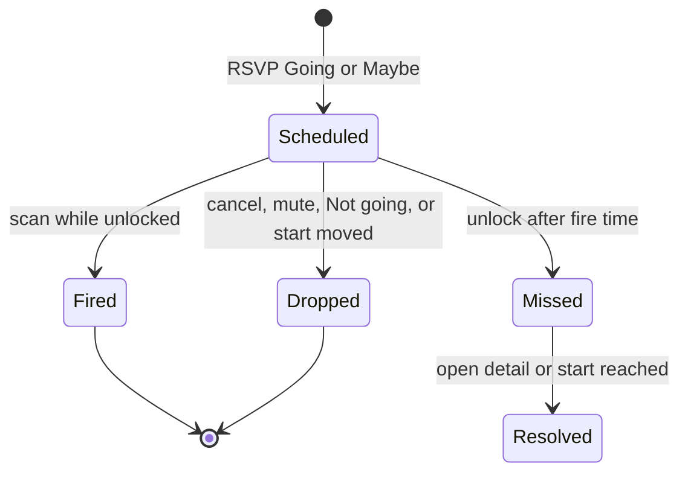

# Squad Events and Local Reminders - Plan

## Goal Capsule

- **Objective:** Squad members can post a meeting, say whether they are coming, and get a reminder on their own device, without a relay or an outsider learning the title, the time, or the place.
- **Means:** NIP-52-shaped fields inside a kind 30078 squad-event rumor on the shared group-records pipe (`docs/plans/2026-11-04-0208-feat-squad-group-records-plan.md`, KTD1 there), plus a local reminder scan started at unlock (KTD4).
- **Authority:** Approved Squad Events requirements, 2026-11-03. Owner decisions below are settled. Shared transport and the restrict switch are owned by the group-records plan.
- **Stop:** Do not implement issues 473, 474, or 475. Do not fire a reminder while the process is not running. Do not put the address or the link in a banner, a Catch up row, or a log.
- **Execution:** Code, after the group-records plan's U1 and U2.
- **Finishes:** An implementer ships the `#events` shelf, RSVP, cancel, and local reminders.

## Product Contract

### Summary

A member creates a timed or all-day event in a squad. It travels as an encrypted rumor in the announcements group and shows on a new `#events` tab next to `#polls`. The tab is cards and actions, not a chat. Members RSVP Going, Maybe, or Not going. The author or a squad admin can edit or cancel. Cancel stays on the card as a status. A weekly choice creates the next eight meetings, and each one is edited on its own. Reminders fire on this device for Going and Maybe, through a new event-reminder notification. A reminder that comes due while the app is closed is a Catch up entry and not a late banner.

Product Contract carried from the approved requirements. No scope change. Planning resolved the deferred questions in the Planning Contract.

### Problem Frame

Squads have polls and no calendar. NIP-52 describes portable calendar events, and it has no recurrence. Pacto's rumor processor does not render kinds 31922, 31923, or 31925 as channel cards. Notifications today fire when a message arrives. `notification::emit` returns immediately when the window is focused, and the only timer in that module is the four-second burst window. Catch up stores source ids, never a title. Nothing scans a clock.

### Key Decisions

- **Events ride the announcements MLS group.** (session-settled: user-directed — chosen over NIP-29: a relay-managed group would see every event and address). Governs R1.
- **NIP-52 field names, inside the encrypted rumor.** Kind numbers 31922, 31923, and 31925 stay in the payload so a later public copy can map them. The MLS rumor kind is 30078 (group-records KTD1). Governs R1, R6.
- **Last authorized save wins. Cancel is a status.** (session-settled: user-directed — chosen over merge, lock, and NIP-09 deletion: deletion does not apply inside MLS). Governs R8, R9.
- **Weekly means the next eight meetings, each edited alone.** (session-settled: user-directed — chosen over "edit this and following" and other repeat rules: those stay in issue 473). Governs R11.
- **Event reminder is its own notification kind, and a missed one goes to Catch up.** (session-settled: user-directed — chosen over reusing the poll action-prompt kind: that kind already writes Catch up on arrival and opens the dashboard). Governs R14, R16.
- **Any member can create until the squad restricts it.** The switch is group-records R5, flag `restrict_event_create`. Governs R12.
- **No reminder while the process is closed.** (session-settled: user-directed — chosen over a push bot: that would learn the time and the attendees, and it is issue 474). Governs R13, R17.

### Requirements

**Creating and reading**

- R1. A member creates an event as an encrypted rumor in the announcements group. The Nostr `d` tag is `pacto_squad_event` on every op. The event id is a JSON `id`, not that tag. Timed events carry NIP-52 kind 31923 as a JSON field, title, start as unix seconds, optional end, and `start_tzid`. All-day events carry kind 31922, start as `YYYY-MM-DD`, and an optional exclusive end. A channel tag is set. Nothing is published in readable form.
- R2. `#events` sits next to `#polls`. It shows a create button and event cards only. Upcoming events, then past ones, by start.
- R3. The channel tag is visible on the card.
- R4. The place is online (a link) or offline (an address). The address is shown only to members, on the event detail, inside the app.
- R5. Each device stores events and RSVPs in its SQLite replica. The `#events` badge counts unseen announcement cards. A weekly series counts once. RSVPs do not count.

**RSVP and mute**

- R6. A member RSVPs Going, Maybe, or Not going, mapped to NIP-52 `accepted`, `tentative`, `declined`. The latest RSVP per member wins. The card shows counts and the member's own answer.
- R7. A member can mute an event on this device. A muted event raises no notification and no reminder, and it does not change the RSVP.

**Edits and cancelling**

- R8. Only the author or a squad admin can edit. The edit reuses the id. The latest authorized edit wins. Every client ignores the others.
- R9. Cancel sets status cancelled. The event stays visible and labeled cancelled, and reminders stop. Only the author or an admin can cancel.

**Time**

- R10. Timed starts render in the viewer's zone. When `start_tzid` differs, the event zone is shown beside them. All-day dates render as the stored civil dates and are not shifted into the viewer zone.

**Weekly**

- R11. Weekly creates eight separate events from the chosen start, stepping seven days in `start_tzid` civil time, each with its own id and a shared series id. Each is edited, cancelled, and RSVP'd on its own.

**Who can create**

- R12. Any member can create while `restrict_event_create` is off. While it is on, only a squad admin can create. Group-records plan owns the flag.

**Reminders**

- R13. The app schedules a reminder for each upcoming event this member RSVP'd Going or Maybe, at a lead before the start. Default lead is 15 minutes. The member can change it per event on this device.
- R14. The reminder uses a new event-reminder notification kind. While the window is focused and the announcements chat level is not Nothing, an in-app notice shows the title and start. While unfocused and the level is not Nothing, the OS banner shows the title and start. Level Nothing shows neither. An on-time reminder does not write Catch up.
- R15. The schedule is dropped or moved when the event is cancelled, the start changes, the event is muted, or the RSVP becomes Not going.
- R16. A reminder that comes due while the process is not running appears in Catch up on next unlock, as an id and a fire time only. No late banner. The event starting, or the member opening it, resolves the entry. Catch up gains an event-reminder kind.
- R17. No reminder runs while the process is closed, and no reminder payload leaves the device.

**Personal info**

- R18. The offline address and the online link stay in the encrypted rumor and the local replica. They are absent from relay-readable events, OS banners, Catch up rows, logs, and exports.
- R19. A banner shows title and start time only.
- R20. RSVP names use the existing member display. Examples in docs use placeholders, not npubs.

### Actors

- A1. Author — creates, and may edit or cancel their event.
- A2. Member — RSVPs, mutes, and may create while the restriction is off.
- A3. Squad admin — edits or cancels any event, and creates while the restriction is on. Admin means group-records KTD3.

### Key Flows

- F1. Create and open
  - **Trigger:** A2 opens `#events` and submits the form.
  - **Steps:** One card rumor lands in `#announcements`. The replica row is the detail. The card links to that detail and does not show the place.
  - **Outcome:** A peer sees the card and the same detail.
- F2. RSVP
  - **Trigger:** A2 chooses Going on the detail.
  - **Steps:** A silent rumor updates counts. A local reminder row is written.
  - **Outcome:** No new announcements line. The peer's counts match.
- F3. Reminder while open
  - **Trigger:** Fire time arrives and the session is unlocked.
  - **Steps:** Title and start are shown. Catch up is not written.
  - **Outcome:** Focused and not Nothing: in-app notice, no OS banner, no Catch up. Unfocused and not Nothing: OS banner, no Catch up. Nothing: neither.
- F4. Missed reminder
  - **Trigger:** Unlock, and the fire time passed while the process was down.
  - **Steps:** Insert a Catch up row. Do not banner.
  - **Outcome:** The row opens the event detail. Opening it, or reaching the start, resolves it.

### Acceptance Examples

- AE1. Two members see the same title, RSVP counts, and cancelled label. A relay capture is ciphertext.
- AE2. A non-member has no address. No banner and no Catch up row contains an address or a link.
- AE3. An edit from someone who is neither author nor admin is ignored on both clients.
- AE4. Going, app open: a reminder appears. Same RSVP, app quit across the fire time: Catch up on unlock, no banner.
- AE5. Weekly produces eight ids. Cancelling the third leaves the other seven active.

### Success Criteria

- AE1 through AE5 hold on two clients in one squad.
- `#events` has no composer and no message list.
- A Nothing chat level produces no banner. A per-event mute produces no banner and no Catch up row.

### Scope Boundaries

**Deferred for later**

- Issue 473: cross-squad calendar, `.ics` export, "edit this and following", other repeat rules, series management.
- Issue 474: reminders while the process is closed.
- Issue 475: public events on Commons. A later public copy must drop the address unless the member opts in.

**Outside this product's identity**

- Server-side scheduling, push providers, and relay-readable calendar events.

**Deferred to Follow-Up Work**

- Republish-for-late-joiners. Empty `#events` uses the same idea as the MLS welcome: history starts at join.
- The announcements scroll-pin gap in `ChatView.svelte` (`docs/solutions/logic-errors/dm-thread-scroll-pin-measured-after-append.md`). Tall cards can fail to follow. Do not fix that shell in this plan.

### Open Questions

- Q1. What clock time does an all-day event remind at? **Recommendation:** 09:00 in `start_tzid`, then subtract the lead. If `start_tzid` is missing, use the viewer's zone. Proceed with that (A2). Timed events use their real start and are unaffected.

### Sources

- Approved Squad Events requirements (Notion, 2026-11-03).
- Group-records plan: `docs/plans/2026-11-04-0208-feat-squad-group-records-plan.md`.
- `docs/dashboard/POLLS.md`, `src/stores/polls-hub-alerts.ts`, `src/components/parent/DashboardPollsPanel.svelte`.
- `src-tauri/src/notification/severity.rs`, `src-tauri/src/notification/emit.rs` (`window_focused` returns before a banner), `src-tauri/src/catch_up.rs`, `src/lib/navigation/open-squad-dashboard.ts`.
- `src-tauri/src/session.rs` `set_key` spawns the idle timer and `clear` aborts it.
- NIP-52 draft: 31923 `start` unix seconds, `start_tzid` IANA; 31922 `start` `YYYY-MM-DD`, end exclusive; 31925 `status` `accepted` | `tentative` | `declined`. No recurrence. NIP-09 delete is not used.

## Planning Contract

### Key Technical Decisions

- KTD1. **Payload schema `pacto.squad_event.v1`, rumor `d` = `pacto_squad_event` on every op.** The event id is JSON `id`. Fields follow NIP-52 names plus Pacto deltas: `place` is `online` or `offline` (NIP-52 has a single `location` tag), `status` is `active` or `cancelled`, `channel_id`, `series_id`, `updated_at_ms`, `op` of `create`, `update`, `rsvp`, `cancel`, or `series_card`. `series_card` carries series id, title, first start, zone, and the count, returns the one announcements card, and inserts no event row. The eight `create` ops stay silent and insert the eight rows. Do not put participant `p` tags on the event. RSVP status uses the NIP-52 words. The group-records plan owns ingest shape and last-write-wins, including the response carve-out in its R3.
- KTD2. **`#events` detail is the only place for the address, the link, RSVP buttons, edit, cancel, the lead, and mute.** The shelf card opens that detail and shows the viewer-local start, channel, cancelled state, RSVP counts, and the viewer's own answer. The announcements card deep-links there. A series card opens `#events` filtered by `series_id`. The card renderer reads the replica at display time and overlays cancelled, or the latest start, so a silent edit does not leave the feed on the old time. The card body stored in the message stays the original create. It never contains `location`. All-day dates stay civil dates and are not shifted into the viewer zone.
- KTD3. **A weekly submit sends eight silent event creates and one summary card.** The card names the title, the first start, the zone, and "8 weekly meetings", and it links to `#events` filtered by `series_id`. The badge increments once, for that card, and skips the author's own create the way poll badges skip own creates. Editing one occurrence does not rewrite the other seven or the card text. The card's live overlay can show how many of the eight are still active.
- KTD4. **Reminders are a local table scanned by a task spawned when the session unlocks.** Copy the lifetime of the idle timer in `Session::set_key` / `clear`: spawn after unlock, abort on lock. Do not spawn while the session mutex is held. Interval is 60 seconds (A3), plus one scan immediately on unlock. The scan does not call `record_admitted_event` for an on-time fire. On-time and focused: emit an in-app event the webview toasts, because `notification::emit` drops focused windows. On-time and unfocused, chat level not Nothing: OS banner with title and start only. Chat level Nothing: no toast and no banner. Missed (fire time already past at unlock, event still active, RSVP still Going or Maybe, not muted): insert Catch up and do not banner.
- KTD5. **Catch up kind `event_reminder`.** `source_event_id` is the event id plus the fire time, so a reschedule can miss again after the first row was resolved. The table stays ids only. The visible label is the kind name and the fire time. It does not show the title, the address, or the link. Open navigates to the event detail, not the squad dashboard. `resolveCatchUpTarget` today sends an announcements `action_prompt` to the dashboard, so this kind needs its own arm.
- KTD6. **Each create payload includes the author's RSVP `accepted`.** A weekly occurrence does not need a second rumor for that RSVP. They can change it. This is A1. Mint the series id and the eight event ids before the first send, and reuse them on retry so a failed submit does not create a second series.

### High-Level Technical Design

Hub row `#events` shares the announcements MLS group id, the way `#polls` does. The panel reads the replica. It does not read a new virtual-bucket timeline.

### Assumptions

- A1. The author's client sends RSVP `accepted` as part of create (KTD6).
- A2. All-day reminders use 09:00 in `start_tzid` minus the lead (Q1).
- A3. The scan interval is 60 seconds. A reminder can appear up to a minute late. That is accepted.
- A4. Empty `#events` for a new member tells them history starts when they joined. No backfill.
- A5. Squad admin and `restrict_event_create` mean the group-records plan. This plan does not redefine them.

### Sequencing

After group-records U1 and U2. U1 then U2 and U3. U4 and U5 depend on U1. U6 depends on U1 and U4. U7 can land with the UI units.

### Effort

| Unit | Engineer-days |
| --- | --- |
| U1. Rumor and replica | 2.5 |
| U2. Events channel and create | 2.5 |
| U3. Announcements card | 1.5 |
| U4. RSVP | 1.0 |
| U5. Edit and cancel | 1.5 |
| U6. Reminders and Catch up | 3.0 |
| U7. Copy | 0.5 |
| **Total** | **12.5** |

### System-Wide Impact

- Hub rows, `ChatView`'s polls branch, `ParentSidebar` badges, `AnnounceCard`, and `tauri-subscriptions` all gain an events case. The docs plan edits the same hub files and `ChatView`. Add the `events` row in this plan. The docs plan adds `docs` beside it.
- `EventKind` and `CatchUpKind` are exhaustive matches. `tier_table_is_exhaustive` in `src-tauri/src/notification/severity.rs` lists kinds by hand. U6 extends that table and `expected_tier`. The TypeScript catch-up kind union in `src/lib/api/catch-up.ts` gains `event_reminder`, or the new row will not type-check.
- `Session::set_key` and `clear` gain a second task beside the idle timer. Abort it on lock. A fire time that passes while locked is the missed path on the next unlock, not a banner during the locked session.
- The location column is member-only replica data. Banners, Catch up inserts, and error strings must not read it.

### Risks

- **Two admins edit at once.** Last `updated_at` wins. The detail shows who wrote that timestamp and when, using the member display name.
- **Late joiner misses a future meeting.** Same MLS limit as polls. A4 is the copy. Do not pretend a resync repairs it.
- **Address in a future export.** The column sits on the replica a later `.ics` or public toggle would read. Those issues must omit it unless the member opts in. This plan adds no export.
- **Focused window and the existing banner path.** KTD4 does not route the on-time case through `EventKind::ActionPrompt`, which would also write Catch up and would still no-op while focused.
- **ChatView merge.** The `#events` branch sits next to `isPollsChannel`. Pull request 431 touches the composer in the same file. Rebase onto main after that pull request if it merges first. Do not branch from it.

## Implementation Units

### U1. Rumor and replica

- **Goal:** Creates, updates, RSVPs, and cancels replicate inside the announcements group and nowhere else.
- **Requirements:** R1, R4, R5, R8, R12, R18. KTD1. Group-records KTD1, KTD2, KTD3.
- **Dependencies:** Group-records U1, U2.
- **Files:** `src-tauri/src/squad_event.rs` (new), `src-tauri/src/rumor.rs`, `src-tauri/src/mls.rs`, `src-tauri/src/cmds/relays.rs`, `src-tauri/src/lib.rs`, new migration `squad_events`, `src/lib/api/squad-events.ts`, `src/lib/api/squad-events.test.ts`.
- **Approach:**
  - `d` = `pacto_squad_event` on every op. A single-meeting `create` returns one announcements message. `series_card` returns the one summary message and inserts no event row. The eight weekly `create` ops are silent and insert eight rows. `update`, `rsvp`, and `cancel` are silent and write no timeline row.
  - Tables: event replica (id, parent, series id, nip52 kind, title, summary, start, end, tzid, place kind, location, channel id, status, author, updated_at, content hash) and RSVP replica (event id, member npub, status, updated_at). Location is the address or the URL.
  - The send command stamps `updated_at_ms` from the backend clock and ignores a client stamp. An unknown `start_tzid` fails before any send. A DST gap uses the first valid local time after the gap. An ambiguous local time uses the earlier offset.
  - Send checks group-records membership, then `restrict_event_create`. Ingest drops non-members, drops edits and cancels that fail author-or-admin, and drops creates that fail the restriction. RSVP author must be the rumor author and a member.
  - Keep an RSVP, edit, or cancel that names an unknown id until the create arrives, then apply it. On apply, re-check author-or-admin for update and cancel against the stored author, and re-check membership for RSVP. Do not use poll first-create-wins.
- **Patterns to follow:** `src-tauri/src/dashboard_poll.rs`. Migration timestamp from `make new-migration`.
- **Test scenarios:**
  - Create then peer ingest stores the row and one announcements message. Location is on the replica and not required on the message JSON.
  - RSVP before create is applied once the create arrives, and it writes no timeline message.
  - Second RSVP from the same member with a later timestamp replaces the status. An older one does not.
  - Update from a non-author non-admin leaves the row.
  - Restriction on: member create is ignored; admin create is stored.
  - Weekly helper from a zoned start yields eight ids, seven days apart in that zone, including a DST spring-forward week that stays on the same civil clock.
  - `series_card` inserts no event row and one announcements message. Eight `create` ops insert eight rows and no timeline messages.
  - A queued update applied after the create is ignored when the stored author is neither the update author nor an admin.
  - An unknown zone is rejected before any rumor is sent. A spring-forward gap uses the first valid local time after the gap. An ambiguous local time uses the earlier offset.
- **Verification:** `cargo test` covers the module. The invoke wrapper is imported by U2.

### U2. Events channel and create

- **Goal:** `#events` lists the replica and can create one meeting or eight.
- **Requirements:** R1, R2, R3, R10, R11. KTD3. A1, A4.
- **Dependencies:** U1.
- **Files:** `src/lib/squad/hub-channel-names.ts`, `src/lib/squad/hub-channel-rows.ts`, `src/lib/parent-navbar.ts`, `src/lib/parent/channel-access.ts`, `src/components/channel/ChatView.svelte` (branch only; leave the file legacy), `src/components/parent/SquadEventsPanel.svelte`, `src/components/parent/CreateEventModal.svelte`, `src/stores/events-hub-alerts.ts`, `src/components/layout/ParentSidebar.svelte`, `src/lib/app/tauri-subscriptions.ts`, tests beside the hub-row helper and `events-hub-alerts.test.ts`.
- **Approach:** Add `events` next to `polls` in the default hub rows, same group id. `ChatView` swaps the timeline and composer for the panel the way `isPollsChannel` does. Form: title, timed or all-day, start, optional end, zone, channel, online link or offline address, weekly checkbox. Weekly submits eight silent creates and one `series_card`. Panel order is upcoming then past. Each shelf card opens `EventDetail`. The card shows the viewer-local start (the civil date, not shifted, when all-day), channel, cancelled state, RSVP counts, and the viewer's own answer. Address, link, RSVP buttons, edit, cancel, lead, and mute stay on the detail. Empty copy states that events from before this member joined are not here. Hide the create button when `restrict_event_create` is on and the caller is not an admin, and show the i18n line. If no current member is admin, show the group-records copy that nobody can add. Do not convert `ChatView.svelte`.
- **Patterns to follow:** `DashboardPollsPanel.svelte`, `CreatePollModal.svelte`, `polls-hub-alerts.ts`.
- **Test scenarios:**
  - Hub backfill inserts `#events` beside `#polls` and does not drop custom channels.
  - Badge counts a summary card once, skips the author's npub, and ignores RSVP replica updates.
  - Weekly payload builder returns eight event ids and one series id.
  - Form rejects an empty title and a link and an address together.
  - A shelf card's open target is that event's detail.
  - The create control is absent when the restriction is on and the caller is not an admin.
- **Verification:** `pnpm test` covers the helpers. The panel is a runes component.

### U3. Announcements card

- **Goal:** `#announcements` shows a place-free card that opens the detail, and a later cancel or time change is visible on that card.
- **Requirements:** R3, R4, R9, R10, R18, R19. KTD2.
- **Dependencies:** U1, U2.
- **Files:** `src/lib/announcements.ts`, `src/lib/announcements.test.ts`, `src/components/announcements/AnnounceCard.svelte`, `src/components/announcements/EventCreatedAnnounceBody.svelte`, `src/components/announcements/AnnounceCard.test.ts`.
- **Approach:** New announce type for a single create and for a series summary. Body renders title, viewer-local start, event zone when it differs, channel name, author. All-day dates stay the civil date and are not converted into the viewer zone. It looks up the replica by event id or series id and appends cancelled, or the count still active. No `location` string is interpolated. A single-event card opens that event's detail. A series card opens `#events` filtered by `series_id`. Activate does not call `requestLinkPreview`.
- **Patterns to follow:** `DashboardPollCreatedAnnounceBody.svelte`.
- **Test scenarios:**
  - Fixture JSON with a location field renders no location substring.
  - Replica status cancelled adds the cancelled label without a second message.
  - Series overlay shows the active count from eight rows when one is cancelled.
  - Zone label appears only when `start_tzid` is not the viewer zone.
  - An all-day start of 2026-03-08 in America/New_York still renders March 8 for a Pacific viewer.
  - A series card activation is the events channel filtered by `series_id`, not a single event id. A single-event card activation is that event's detail.
- **Verification:** Announce tests pass and the card component test has no preview call.

### U4. RSVP

- **Goal:** Going, Maybe, and Not going update counts and the local reminder inputs.
- **Requirements:** R6, R13, R15, R20. KTD6.
- **Dependencies:** U1.
- **Files:** `src/components/parent/EventDetail.svelte`, RSVP handler in `src-tauri/src/squad_event.rs` tests, `src/lib/api/squad-events.test.ts`.
- **Approach:** Detail shows counts and the member's status. Names use the existing member display and never a raw npub. Buttons send the silent RSVP. Create flow also sends `accepted` for the author. Not going removes this device's pending reminder. Going and Maybe schedule one.
- **Patterns to follow:** Poll vote button on `DashboardPollsPanel.svelte`.
- **Test scenarios:**
  - Three members' statuses produce counts 1, 1, 1.
  - A later `declined` replaces `accepted` for that npub only.
  - Author create leaves an `accepted` row for the author.
  - A fixture npub renders as the member display label, not the npub string.
- **Verification:** Replica tests and the API test agree on the status words `accepted`, `tentative`, `declined`.

### U5. Edit and cancel

- **Goal:** Author or admin can change fields or cancel, and everyone else's clients follow.
- **Requirements:** R8, R9, R10, R15, R20. KTD2.
- **Dependencies:** U1, U4.
- **Files:** `src/components/parent/EventDetail.svelte`, `src-tauri/src/squad_event.rs` tests.
- **Approach:** Edit sends `op` update with the same id and a newer `updated_at_ms`. Cancel sends `op` cancel. The detail shows the writer of the winning timestamp using the same member display, never a raw npub. Edit is `EditIconButton`, icon only, with an `ariaLabel`. A start change moves the local fire time and does not write Catch up for the abandoned time. Cancel deletes pending local fires and does not write Catch up.
- **Test scenarios:**
  - Author update changes the start. A peer on the older timestamp keeps the new start after ingest.
  - Non-admin other member update is ignored.
  - Cancel sets status and leaves the row in the list.
  - One series occurrence cancel leaves the other ids active.
  - The edit-writer line is the member display label, not the npub string.
- **Verification:** The ingest tests cover ignore and last-write-wins. The detail hides edit controls when the caller is neither author nor admin.

### U6. Reminders and Catch up

- **Goal:** On-time reminders show while unlocked. Missed ones are Catch up entries with no banner.
- **Requirements:** R7, R13, R14, R15, R16, R17, R19. KTD4, KTD5. A2, A3.
- **Dependencies:** U1, U4.
- **Files:** `src-tauri/src/squad_event_reminders.rs` (new) or the reminder section of `squad_event.rs`, `src-tauri/src/session.rs` (spawn and abort next to the idle timer, not under its mutex), `src-tauri/src/notification/severity.rs`, `src-tauri/src/catch_up.rs`, `src/lib/api/catch-up.ts`, `src/lib/navigation/open-squad-dashboard.ts`, `src/lib/navigation/open-squad-dashboard.test.ts`, `src/components/catch-up/CatchUpEntry.svelte`, `src/components/catch-up/CatchUpFilters.svelte`, `src/lib/i18n/locales/en/notifications.json`, `src/lib/i18n/locales/es/notifications.json`, mute table in the events migration, in-app listener in `src/lib/app/tauri-subscriptions.ts`.
- **Approach:**
  - Local rows: event id, fire time, lead minutes, state. Mute is a local row, never a rumor.
  - Mute is a control on `EventDetail` for every member, default unmuted. Its visible label comes from `events.json`. It is not the words Edit or Refresh, and it is not `EditIconButton`.
  - Mute writes the local row, clears a pending reminder, and blocks Catch up. Unmute reschedules when the RSVP is Going or Maybe.
  - Default lead 15, overridable on the detail, stored only locally.
  - Schedule only for Going and Maybe, not muted, not cancelled, start still ahead.
  - Banner and toast copy are title and start. Build that string in Rust the way the poll sentence is built, with no location field on the struct.
  - Logs print the event id and counts only. They do not include the title, the address, the link, or a URL.
  - Unlock scan writes Catch up only when the fire is past, the event is still active, the RSVP still qualifies, and the event is not muted. Then mark that fire handled so a second unlock does not insert again. `source_event_id` includes the fire time.
  - Opening the detail and crossing the start both resolve that entry.
  - Start the loop from the unlock path that already calls `Session::set_key`. Do not add a command that nothing calls.
  - Extend `tier_table_is_exhaustive` and `expected_tier` with `EventReminder`. Extend the catch-up kind union in `src/lib/api/catch-up.ts`.
- **Patterns to follow:** `earns_catch_up_entry` stays unchanged for other kinds. Idle-timer spawn in `session.rs`. Catch up insert `ON CONFLICT(source_event_id) DO NOTHING`.
- **Test scenarios:**
  - Going at lead 15 schedules `start - 15 minutes`. Maybe does too. Declined and no RSVP do not.
  - Muted Going does not schedule. Cancel deletes a pending row and the missed scan does not insert Catch up.
  - Focused on-time path emits the in-app event and does not insert Catch up. Unfocused on-time path requests a banner whose body has no location. Nothing level does neither.
  - Unlock after the fire time inserts one Catch up row and no banner. A second unlock does not insert another.
  - A new fire time after an edit can insert a second Catch up row when that later fire is also missed.
  - All-day event with `start_tzid` America/New_York and lead 15 schedules 08:45 in that zone.
  - Catch up navigation for kind `event_reminder` returns the events channel and the event id, not the dashboard.
  - The Catch up table insert has no title column. The rendered label is the kind name and the fire time, not the replica title.
- **Verification:** `cargo test` covers the scanner with a fixed clock. `pnpm test` covers navigation. No new env var.

### U7. Copy

- **Goal:** Every new user-facing string exists in English and Spanish.
- **Requirements:** R2, R10, R14, R16, R20.
- **Dependencies:** U2, U3, U6.
- **Files:** `src/lib/i18n/locales/en/events.json`, `src/lib/i18n/locales/es/events.json`, additions in `announcements.json` and `notifications.json` for both locales.
- **Approach:** New `events.*` keys for the panel, form, RSVP, and mute. Announce badges in `announcements.json`. Catch up kind label in `notifications.json`. No hardcoded English in the new Svelte files. Fixtures and examples use placeholders, not npubs. The Rust banner sentence stays a fixed title-plus-time string, matching the poll banner, and it must not include the place.
- **Test scenarios:**
  - `messages.test.ts` passes with the new keys paired.
  - A render fixture for the card contains no raw English outside `$t`.
- **Verification:** `pnpm test` locale check and `pnpm lint` report no new raw-text warnings on the new components.

## Verification Contract

| Check | Command | Applies |
| --- | --- | --- |
| Rust tests | `cargo test --lib` from `src-tauri` | U1, U4, U5, U6 |
| Frontend tests | `pnpm test` | U2, U3, U6, U7 |
| Types | `pnpm check` | UI units |
| Lint | `pnpm lint` | UI units |
| Command wiring | `pnpm check:tauri-commands` | U1 |
| Two-client smoke | Create, RSVP, cancel, and a reminder with the app open. Quit across a fire time and confirm Catch up. Confirm the banner text has no address. | U2 through U6 |

The smoke is manual or sandbox. This plan does not add a relay-readable fixture.

## Definition of Done

- Two members share replica rows. RSVP and cancel add no announcements line.
- A non-author non-admin edit is ignored.
- Weekly yields eight independent rows and one card.
- Reminders stay on the device. Closed process means Catch up, not a banner.
- Address and link are absent from banners, Catch up columns, and logs.
- Group-records policy is consulted and not reimplemented.
- Abandoned experiments are not left in the diff.
