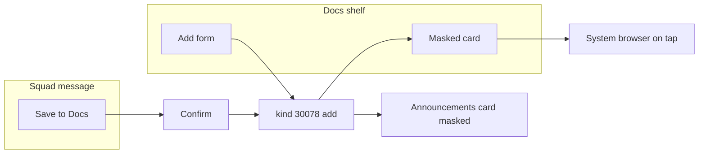

# Squad Docs Shelf - Plan

## Goal Capsule

- **Objective:** A squad can keep its shared doc links in one list, and a member can save a link from chat, without a relay, a doc provider, or an outsider learning which docs the squad uses.
- **Means:** Kind 30078 doc rumors on the shared group-records pipe (`docs/plans/2026-11-04-0208-feat-squad-group-records-plan.md`), a `#docs` shelf, and display masking of URL secrets (KTD2).
- **Authority:** Approved Squad Docs Shelf requirements, 2026-11-03. Shared transport and the restrict switch are owned by the group-records plan.
- **Stop:** Do not branch from pull request 431. Do not implement issues 476, 477, or 478. Do not fetch a doc URL for a preview from the shelf or from Save to Docs.
- **Execution:** Code, after group-records U1 and U2. Rebase onto main if pull request 431 merges first.
- **Finishes:** An implementer ships the shelf, Save to Docs, masked cards, and the Commons warning.

## Product Contract

### Summary

Each doc link is an encrypted rumor in the announcements group and a row in the local replica. A Docs virtual channel lists them, with a channel filter. A squad message that contains a link can be saved from the message menu. CryptPad keys, the URL fragment, never leave MLS and are masked on screen. Adding a link posts an announcements card with the key masked. A one-time warning appears when a keyed link is about to be published on Commons. There are no automatic previews of shelf links.

Product Contract carried from the approved requirements. No scope change. Planning resolved the deferred questions in the Planning Contract.

### Problem Frame

Links in chat scroll away. Pins are per channel. Polls already show how a squad-wide list can ride the announcements group. CryptPad puts the decryption key in the URL fragment, so the fragment is a password. Chat today linkifies the full URL, fragment included, and `requestLinkPreview` will fetch an https URL. `AnnounceCard` does not request a preview. The message menu is `MessageActionsMenu.svelte`, mounted by `Message.svelte`. Announce cards never mount it.

### Key Decisions

- **Links ride the announcements MLS group.** (session-settled: user-directed — chosen over NIP-51 lists and NIP-29: those either encrypt to the author only or show the relay the URL). Governs R1.
- **Provider is a local hostname check.** No network call classifies a link. Governs R3.
- **No automatic preview of a shelf link.** (session-settled: user-directed — chosen over fetching the page: the provider would see the member's IP and that this squad uses the doc; opt-in previews are issue 476). Governs R13.
- **Author or admin edits and removes.** Last save wins. Admin means group-records KTD3. Governs R9.
- **Adding posts a masked announcements card.** (session-settled: user-directed — chosen over no card and over a card that shows the full URL). Governs R14, R16.
- **Any member can add until the squad restricts it.** The switch is group-records R5, flag `restrict_doc_add`. (session-settled: user-directed — chosen over admin-only as the default). Governs R10.
- **A keyed link pasted into a public composer warns once.** (session-settled: user-directed — chosen over always warning and over never warning). Governs R15.
- **This work does not build on the voice-messages branch.** (session-settled: user-directed — chosen over branching from pull request 431: that branch is still open and its conflicts are limited). Governs the dependency note below.

### Requirements

**Record and transport**

- R1. A member adds a doc link as an encrypted kind 30078 rumor, `d` = `pacto_squad_doc`, schema `pacto.squad_doc.v1`, in the announcements group. Fields: id, url, title, provider, optional channel id, note, added_by, updated_at, op `add`, `update`, or `remove`. Nothing is published in readable form.
- R2. Each device keeps the rows locally. `remove` hides the link on every client.
- R3. Provider is `cryptpad`, `google`, `zoho`, `notion`, `etherpad`, or `other`, from the hostname on the adding device. Any http or https URL is accepted. Unknown hosts are `other`.

**Shelf**

- R4. A Docs virtual channel sits with `#polls` and `#events`. It shows an add button and cards, and no chat.
- R5. A card shows title, provider, channel tag if any, note, who added it, and when. Newest first.
- R6. The shelf filters All, one channel, or Untagged. A channel can open that filter directly.
- R7. Opening a card launches the full URL, fragment included, in the system browser, only after a tap.

**Save to Docs**

- R8. A squad-channel message with at least one http or https link offers Save to Docs. It pre-fills the URL, a title from the link text or the hostname, and the channel. The member can edit those before saving. Several links require a pick.

**Edit and remove**

- R9. Only the author or a squad admin can edit or remove. The id is reused. The latest authorized write wins. Others are ignored.
- R10. Any member can add while `restrict_doc_add` is off. While it is on, only a squad admin can add.

**Fragment safety**

- R11. The fragment is stored and sent only inside the MLS record. It is absent from relay-readable events, other servers, logs, notifications, Catch up, and analytics.
- R12. On the shelf, the fragment is masked, with tap-to-reveal. Copy copies the full URL only from an explicit copy control.
- R13. The shelf and Save to Docs do not fetch the URL.

**Notifications**

- R14. Add posts one announcements card and counts toward the Docs unseen badge. Edit and remove post no card and do not count.

**Public warning and card masking**

- R15. Publishing a link that contains a key into a public composer, such as Commons, shows a one-time warning that the link lets anyone open the doc. The member can still publish.
- R16. The announcements card shows title, provider, channel, and who added it. The key is masked the same way as the shelf's default view. The full URL stays in the encrypted record. The card raises no notification text that contains the URL or the note.

**Personal info**

- R17. Notes stay in the replica. They are absent from notifications and Catch up.
- R18. Logs contain link ids and counts only.

### Actors

- A1. Member — adds, or saves from a message, while the restriction is off.
- A2. Author — edits or removes their row.
- A3. Squad admin — edits or removes any row, and adds while the restriction is on.

### Key Flows

- F1. Add from the shelf
  - **Trigger:** A1 submits the add form.
  - **Steps:** One card rumor and one replica row. The card shows a masked URL.
  - **Outcome:** A peer sees the same row and the same mask.
- F2. Save from chat
  - **Trigger:** A1 opens the message menu on a squad message that contains a URL.
  - **Steps:** Confirm the pre-filled fields. Send the add.
  - **Outcome:** The shelf row is tagged with that channel.
- F3. Commons warning
  - **Trigger:** A1 publishes Commons text that contains a keyed URL, and this npub has not confirmed the warning on this profile.
  - **Steps:** The warning is shown. Cancel returns to the draft and does not record the confirmation. Confirm records it and publishes the text unchanged.
  - **Outcome:** A later keyed link on either Commons composer does not warn again for this npub on this profile.

### Acceptance Examples

- AE1. Two members see the same list and the same channel filter. A relay capture is ciphertext.
- AE2. A CryptPad fragment appears in no request outside MLS, no log, and no notification.
- AE3. Save to Docs on a message tags the row with that channel.
- AE4. An edit or remove from someone who is neither author nor admin is ignored.
- AE5. The shelf and Save to Docs make no request to the doc host until the member opens the card. Ordinary chat preview may still fetch the URL after the fragment and secret query values are removed.

### Success Criteria

- AE1 through AE5.
- The announcements card and the shelf's default view show the same mask.
- Voice messages do not offer Save to Docs.

### Scope Boundaries

**Deferred for later**

- Issue 476: opt-in previews and link health, including a manual "mark broken".
- Issue 477: native encrypted notes.
- Issue 478: Google and Zoho OAuth.
- Folders, search, and sort orders beyond the channel filter.

**Outside this product's identity**

- Granting access to the doc itself. A Google or Zoho link may still require that provider's account.

**Deferred to Follow-Up Work**

- Late joiners do not see links saved before their welcome. Empty shelf copy says history starts at join. No republish.
- Rewriting historical chat bubbles that already showed a full URL. Masking applies to the shelf and the card.

### Dependencies

- Group-records plan U1 and U2, including `restrict_doc_add`.
- Pull request 431 (voice messages, open) edits `src/components/channel/ChatView.svelte`, `src/components/dm/DmThread.svelte`, `MessageInput.svelte`, `MessageAttachment.svelte`, and the ends of `en` and `es` `messaging.json`. It does not edit `MessageActionsMenu.svelte`. Branch from main. If 431 merges first, rebase. Expect a conflict in `ChatView.svelte` where this plan adds the Docs branch and the Save to Docs callback. Avoid a `messaging.json` conflict by inserting the new keys beside `messaging.message.copy`, not at the end of the file. Voice clips have no URL, so the menu item stays hidden.

### Open Questions

None that block this plan. The admin identity question is group-records Q1. This plan uses that answer.

### Sources

- Approved Squad Docs Shelf requirements (Notion, 2026-11-03).
- Group-records plan and the events plan's hub-row pattern.
- `src/components/dm/MessageActionsMenu.svelte`, `src/components/dm/Message.svelte`.
- `src/lib/messaging/link-preview.ts`, `src/lib/utils/message-formatting.ts`, `src-tauri/src/message.rs` `fetch_msg_metadata`.
- `src/components/commons/UserCommonsBroadcastPanel.svelte`, `src/components/commons/BroadcastSquadModal.svelte`.
- `src/stores/persistence-context.ts` `persistenceKey`.

## Planning Contract

### Key Technical Decisions

- KTD1. **Schema `pacto.squad_doc.v1`, `d` = `pacto_squad_doc`.** `add` is the announcements card. `update` and `remove` are silent, group-records KTD1. `remove` sets a hidden flag. The row stays so a late older add cannot revive it. Last `updated_at` wins.
- KTD2. **Store the raw URL in the replica. Mask only display and the announcements card.** Tap-to-reveal and the explicit copy control exist on the shelf card. The announcements card stays masked and has no reveal. Open uses the raw URL in the system browser.
- KTD3. **Mask every non-empty fragment, and mask query values whose names are on the secret list.** Display `path` plus `#••••` when a fragment exists. Replace secret query values with `••••`. The list is `token`, `access_token`, `id_token`, `refresh_token`, `api_key`, `apikey`, `key`, `secret`, `sig`, `signature`, `auth`, `password`, `code`, case-insensitive, plus the names already stripped as trackers. The path stays visible, including a Google or Notion id. Those ids are how a member recognizes the doc. Treating the whole path as a key would make the card useless, and the requirements' example is the fragment.
- KTD4. **Save to Docs is a menu item on `MessageActionsMenu`, after Copy and before Reply.** It is passed only from squad `ChatView`, not from DMs. One http(s) URL saves that URL. Several open a picker. The shelf stores the URL from the save, not a live binding to the message. A later message edit does not change the row. Dedup identity is host, path, the non-secret query, and the fragment. A different fragment is a new id. The same full URL returns the existing id. If the caller is not the author or an admin, do not send an update and do not rewrite the local row; open the existing shelf row. Ingest of a second `add` for the same id from anyone else is a no-op. When `restrict_doc_add` is on and the caller is not an admin, omit the menu item.
- KTD5. **A message whose MLS group is not the announcements group asks before save.** The confirm states that the whole squad will be able to open the link, because the shelf rumor is in the announcements group. Custom channels are separate groups with a subset of members.
- KTD6. **Chat preview fetches drop the fragment and the secret query list before `fetch_msg_metadata`.** Ordinary messages already fetch https URLs, and a secret query would leave the device on scroll. Fragments are removed too so the stored preview identity is not the key. The shelf and Save to Docs still do not call preview. This is the strip the requirements asked for once previews were confirmed.
- KTD7. **The warning runs in both Commons composers, once per npub via `persistenceKey`.** Detection is a non-empty fragment or a secret-list query with a non-empty value, on any host. Cancel aborts that publish and does not set the flag. Confirm sets the flag and publishes the draft unchanged. Squad chat is not a public composer, so it does not warn.

### High-Level Technical Design

### Assumptions

- A1. Group-records Q1 is the admin set. `restrict_doc_add` is that plan's flag.
- A2. Announcements cards do not reveal. Shelf cards do (KTD2).
- A3. Preview stripping in KTD6 ships in this plan because the current fetch keeps secret query values.
- A4. `http://` is offered and accepted, matching R3. The warning uses the same key test as https.

### Sequencing

After group-records U1 and U2. Can run in parallel with the events plan. Both edit `ChatView.svelte` and the hub row helpers. Land the hub-row edits in one of the two plans if they would conflict, and have the other rebase. Prefer the events plan to add its channel first, and this plan to add `docs` beside it.

Do not start from the voice-messages branch.

### Effort

| Unit | Engineer-days |
| --- | --- |
| U1. Rumor and replica | 2.0 |
| U2. Shelf and filter | 2.0 |
| U3. Announcements card | 1.0 |
| U4. Save to Docs | 2.0 |
| U5. Mask and preview strip | 1.5 |
| U6. Commons warning | 1.0 |
| U7. Copy | 0.5 |
| **Total** | **10.0** |

### System-Wide Impact

- KTD6 changes preview fetch for every https message, not only shelf links. A `?token=` link in ordinary chat stops sending that value to the host. The page preview can still load. The fragment never identified the page on the wire. Tracker stripping stays as it is.
- `Message.svelte` grows an optional callback. DM mounts omit it, so DM menus do not gain the item.
- `ChatView.svelte` and the hub-row helpers are also edited by the events plan and by pull request 431. This plan adds the Docs branch and the menu callback. It does not take the voice commits.
- Both Commons composers share one warning helper. A flag written by one composer applies to the other.

### Risks

- **Screenshot and public paste.** Masking and the warning reduce mistakes. They do not stop a member who confirms the warning. The published Commons text still contains the key, which is the member's choice under R15.
- **Last save wins.** The card shows who wrote the winning timestamp and when.
- **Private-channel save.** KTD5 is the confirm. Skipping it would show a leadership URL to the whole squad.
- **Path secrets.** Google and Notion ids stay visible inside the squad. They are already visible to members who hold the raw URL. They are masked only for the fragment and the secret query list.
- **Pull request 431.** Conflict is expected in `ChatView.svelte`. `messaging.json` stays clear of the voice keys if the new keys sit beside `messaging.message.copy`.

## Implementation Units

### U1. Rumor and replica

- **Goal:** Adds, updates, and removes replicate in the announcements group.
- **Requirements:** R1, R2, R3, R9, R10, R11, R18. KTD1.
- **Dependencies:** Group-records U1, U2.
- **Files:** `src-tauri/src/squad_doc.rs` (new), `src-tauri/src/rumor.rs`, `src-tauri/src/mls.rs`, `src-tauri/src/cmds/relays.rs`, `src-tauri/src/lib.rs`, new migration `squad_docs`, `src/lib/api/squad-docs.ts`, `src/lib/api/squad-docs.test.ts`, `src/lib/docs/provider.ts`, `src/lib/docs/provider.test.ts`.
- **Approach:**
  - Add returns an announcements message whose JSON uses the masked display URL, never the raw fragment. The replica stores the raw URL.
  - Update and remove are silent.
  - Provider map: host contains `cryptpad` → `cryptpad`; `docs.google.` or `drive.google.` → `google`; `zoho` → `zoho`; `notion.` → `notion`; `etherpad` → `etherpad`; else `other`.
  - Ingest enforces author-or-admin on update and remove, and `restrict_doc_add` on add.
  - Logs print the doc id and counts only. Do not treat `redact_urls_in_text` as the control: it keeps fragments and misses `sig`, `signature`, and `code`. Store the author from the MLS signer. If `added_by` is present and differs from that signer, ignore the rumor. Edit, remove, and the card's "who added" use the stored signer.
- **Patterns to follow:** `dashboard_poll.rs` and the group-records policy module.
- **Test scenarios:**
  - Add stores the raw URL in SQLite and the message JSON has no fragment and no secret query value.
  - Update from a non-author non-admin is ignored.
  - Remove hides the row. An older add for the same id does not unhide it.
  - Restriction on: member add ignored, admin add stored.
  - Hostname cases: `cryptpad.fr` → cryptpad, `docs.google.com` → google, `example.com` → other.
  - Non-http URL is rejected.
  - A rumor whose `added_by` differs from the MLS signer is ignored.
  - A second `add` for an existing id from anyone else is a no-op.
  - Log fixtures contain the doc id and a count, and contain no URL.
- **Verification:** `cargo test` and `pnpm test` for the provider map. The wrapper is imported by U2.

### U2. Shelf and filter

- **Goal:** `#docs` lists rows and can add one, filtered by channel.
- **Requirements:** R4, R5, R6, R7. A4 from the events plan's empty-state idea, repeated here as shelf copy.
- **Dependencies:** U1. Hub helper from the events plan if that plan has already added `events`; otherwise add `docs` the same way `#polls` is added.
- **Files:** `src/lib/squad/hub-channel-names.ts`, `src/lib/squad/hub-channel-rows.ts`, `src/lib/parent-navbar.ts`, `src/lib/parent/channel-access.ts`, `src/components/channel/ChatView.svelte` (Docs branch only), `src/components/parent/SquadDocsPanel.svelte`, `src/components/parent/AddDocModal.svelte`, `src/components/parent/DocsChannelButton.svelte` (runes, mounted from the legacy channel header), `src/stores/docs-hub-alerts.ts`, `src/components/layout/ParentSidebar.svelte`, tests for the filter helper and the badge.
- **Approach:** Panel is add button plus cards, newest `updated_at` first, hidden rows omitted. Filter All, a channel id, or Untagged. `DocsChannelButton` opens the shelf with that channel pre-selected. Empty copy says links from before this member joined are not listed. Do not convert `ChatView.svelte`. Author or admin see `EditIconButton` (icon only, `ariaLabel`, no visible Edit) opening `AddDocModal` prefilled, plus a separate remove control that is not labeled Edit or Refresh, with confirm, sending silent `remove`. Hide both for everyone else. When `restrict_doc_add` is on and the caller is not an admin, hide Add and show the i18n line. If no current member is admin, show the group-records copy that nobody can add. Title, reveal, and copy are separate gestures, specified in U5. The panel does not fetch metadata.
- **Patterns to follow:** `DashboardPollsPanel.svelte`, `polls-hub-alerts.ts`.
- **Test scenarios:**
  - Filter Untagged returns rows with no channel id and excludes a row tagged `general`.
  - Newest updated row is first.
  - Hidden row is absent.
  - Badge counts adds, skips the author's npub, and ignores updates.
  - Hub backfill keeps custom channels and includes `docs`.
  - A non-author non-admin render has no edit control and no remove control.
  - A restricted non-admin render has no add button.
- **Verification:** `pnpm test` covers filter and badge. The panel is runes.

### U3. Announcements card

- **Goal:** The add card shows the masked link and no note.
- **Requirements:** R14, R16, R17. KTD2.
- **Dependencies:** U1, U5's mask helper can land first or with this unit.
- **Files:** `src/lib/announcements.ts`, `src/lib/announcements.test.ts`, `src/components/announcements/AnnounceCard.svelte`, `src/components/announcements/DocAddedAnnounceBody.svelte`.
- **Approach:** Render title, provider, channel, author, masked URL. Do not render `note`. Do not call `requestLinkPreview`. No reveal control.
- **Patterns to follow:** `DashboardPollCreatedAnnounceBody.svelte`.
- **Test scenarios:**
  - Fixture with a CryptPad fragment renders `#••••` and not the fragment.
  - Fixture note text is absent from the card.
  - The card component does not import the preview module.
- **Verification:** Announce tests pass.

### U4. Save to Docs

- **Goal:** The message menu saves one chosen URL, and a private channel warns first.
- **Requirements:** R8, R10. KTD4, KTD5.
- **Dependencies:** U1, U2.
- **Files:** `src/components/dm/MessageActionsMenu.svelte`, `src/components/dm/MessageActionsMenu.test.ts`, `src/components/dm/Message.svelte`, `src/components/channel/ChatView.svelte`, `src/lib/docs/message-links.ts`, `src/lib/docs/message-links.test.ts`. `src/components/dm/DmThread.svelte` stays unchanged so DMs do not pass the callback.
- **Approach:** New optional callback. The item renders only when the callback is set, the message text has an http(s) URL, and the caller may add (`restrict_doc_add` off, or the caller is an admin). Extract URLs with the existing URL scan. One URL opens the add modal pre-filled. Several open a picker first. Title pre-fill is the anchor text when it is not the URL, otherwise the hostname. Channel id is the channel the message was rendered in. If that channel's MLS group id is not the announcements group id, the modal requires the whole-squad confirm before send. Voice and other messages with no URL show no item. Announce cards are unchanged and have no menu. A second save of the same full URL by someone who is not the author or an admin opens the existing shelf row and sends nothing.
- **Patterns to follow:** Copy button in `MessageActionsMenu.svelte`.
- **Test scenarios:**
  - Text with no URL omits the item. Text with one URL calls the callback with that URL.
  - Text with two URLs yields both for the picker and does not send until one is chosen.
  - A message group id different from the announcements group id blocks send until confirm.
  - The DM mount does not pass the callback, so the item is absent.
  - Dedup helper: the same host, path, non-secret query, and fragment returns the existing id. A different fragment returns a new id.
  - A second save by someone who is not the author or an admin does not send an update and does not rewrite the local row.
  - The menu item is omitted when the restriction is on and the caller is not an admin.
- **Verification:** Menu tests and the link helper tests pass. `ChatView` diff is the callback plus the Docs branch, not a runes conversion.

### U5. Mask and preview strip

- **Goal:** Display masks secrets, and the existing preview fetch stops sending them.
- **Requirements:** R11, R12, R13. KTD2, KTD3, KTD6.
- **Dependencies:** U1.
- **Files:** `src/lib/docs/mask-url.ts`, `src/lib/docs/mask-url.test.ts`, `src/lib/messaging/link-preview.ts`, `src/lib/utils/url-tracking.ts` if the secret list lives next to the tracker list, the Rust candidate builder in `src-tauri/src/message.rs` or `src-tauri/src/util.rs` so the backend cannot fetch a secret the UI already stripped, and their tests.
- **Approach:** One mask function used by the shelf, the card, and the preview candidate. On the shelf card, the title control opens the system browser with the raw URL. Tapping the masked URL reveals it in place and does not navigate. Copy is a third button that writes the raw URL. The announcements card has neither reveal nor copy. Preview candidate drops the fragment and replaces secret query values before `fetch_msg_metadata`. Shelf open and Save to Docs do not call that function.
- **Patterns to follow:** `stripTrackingParamsFromUrl` in `src/lib/utils/url-tracking.ts`.
- **Test scenarios:**
  - `https://cryptpad.fr/pad/#/2/pad/edit/secret` displays with `#••••` and copies the original from the copy helper.
  - `?token=abc&x=1` displays `token=••••` and keeps `x=1`.
  - Preview candidate for that URL has no fragment and no `token` value.
  - A path-only Google docs URL is unchanged.
  - Empty fragment does not add `#••••`.
  - Title activation is the raw URL open. Masked-URL activation flips reveal and does not open.
- **Verification:** Frontend and Rust tests cover the same fixture URLs and agree.

### U6. Commons warning

- **Goal:** Both public composers warn once per npub, and Cancel does not consume the warning.
- **Requirements:** R15. KTD7.
- **Dependencies:** U5's detector.
- **Files:** `src/components/commons/UserCommonsBroadcastPanel.svelte`, `src/components/commons/BroadcastSquadModal.svelte`, `src/lib/docs/keyed-link-warning.ts`, `src/lib/docs/keyed-link-warning.test.ts`, `src/lib/i18n/locales/en/commons.json`, `src/lib/i18n/locales/es/commons.json`.
- **Approach:** Before `publishUserCommonsBroadcast` and `publishSquadCommonsBroadcast`, if the detector matches and `persistenceKey` has no confirmation, show the warning. Cancel leaves the draft and does not write the key. Confirm writes the npub-scoped key and publishes the same string. Do not hook `MessageInput.svelte`.
- **Patterns to follow:** `persistenceKey` in `src/stores/persistence-context.ts`.
- **Test scenarios:**
  - Fragment URL and a `secret` query URL both warn. A plain `https://example.com/a` does not.
  - Cancel leaves the stored flag unset.
  - Confirm sets the flag. A second call does not ask.
  - The flag key includes the npub, so another account on the same profile still warns.
- **Verification:** The helper tests pass. Both composers call the helper. A spot read shows `MessageInput.svelte` was not edited for this warning.

### U7. Copy

- **Goal:** New strings exist in English and Spanish, including the menu label next to the existing message actions.
- **Requirements:** R8, R12, R15, R16.
- **Dependencies:** U2, U4, U6.
- **Files:** `src/lib/i18n/locales/en/docs.json`, `src/lib/i18n/locales/es/docs.json`, `messaging.json` keys beside `messaging.message.copy` in both locales, `announcements.json`, `commons.json`.
- **Approach:** Menu label `messaging.message.saveToDocs` sits with `messaging.message.copy`, `reply`, and `edit`. Do not append it at the end of `messaging.json`.
- **Test scenarios:**
  - Locale pair test passes.
  - The menu test reads the save key, not a hardcoded English label.
- **Verification:** `pnpm test` and `pnpm lint` on the new components.

## Verification Contract

| Check | Command | Applies |
| --- | --- | --- |
| Rust tests | `cargo test --lib` from `src-tauri` | U1, U5 |
| Frontend tests | `pnpm test` | U1 through U7 |
| Types | `pnpm check` | UI units |
| Lint | `pnpm lint` | UI units |
| Command wiring | `pnpm check:tauri-commands` | U1 |
| Smoke | Two clients: add, filter, save from a message, masked card, title opens the browser, masked URL reveals in place. Commons cancel then a second keyed paste still warns. Shelf and Save to Docs make no doc-host request until the card is opened. Ordinary chat may still preview a stripped URL. | U2, U4, U5, U6 |

Branch from main. After pull request 431 merges, rebase. Expect a conflict in `ChatView.svelte`. `messaging.json` stays clear of that conflict when the new keys sit beside `messaging.message.copy`.

## Definition of Done

- Two members share the shelf. Add is a masked card. Update and remove are silent.
- A non-author non-admin edit is ignored.
- Save to Docs tags the channel and asks before leaving a private channel.
- Fragments and secret query values are absent from preview fetches, cards, notifications, and logs.
- The Commons warning is once per npub, on both composers, and Cancel does not consume it.
- The branch does not contain the voice-messages commits.
- Abandoned experiments are not left in the diff.
