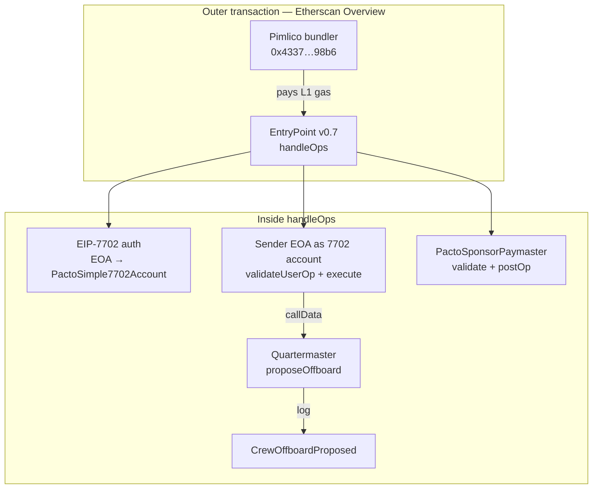
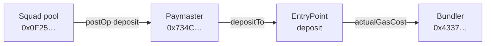

# Sponsored UserOp — Sepolia walkthrough

Worked example of one **squad-sponsor** ERC-4337 + EIP-7702 write. Normative transport rules: [SPONSORED_USEROP_7702.md](./SPONSORED_USEROP_7702.md). Squad paymaster / pool ops: [PACTO_SQUAD_SPONSOR.md](./PACTO_SQUAD_SPONSOR.md).

## Transaction

[Sepolia `0xa6f0e670…977ed7`](https://sepolia.etherscan.io/tx/0xa6f0e67092af09683ea0419d2ab70ac7ef3283f554cfc90e472eb3624f977ed7)

| Role | Address |
|------|---------|
| Outer `from` (Pimlico bundler) | `0x4337005db25DbAD41Da5692ba1188751eE5D98b6` |
| Outer `to` (EntryPoint v0.7) | `0x0000000071727De22E5E9d8BAf0edAc6f37da032` |
| UserOp sender (roster EOA, 0 ETH) | `0x2634FA7c040F903686A0F62B1a10883143B70a3b` |
| EIP-7702 impl (`PactoSimple7702Account`) | `0x2E9156deE65d7946305C334824e2648Ff9128f45` |
| Squad paymaster | `0x734Cd82B6732f2067De52A3B9F6a5f86843ee424` |
| Squad sponsor pool | `0x0F25d460cb9787D6e46e09a97f67f04e0A9ca02F` |
| Inner target (Quartermaster clone) | `0xe0e157cea035ee52e8d2f030254c986ed5cc8e28` |
| `proposeOffboard` argument | `0x3cc5B4406777382d8Ee6F00F6d3917504c679644` |

**App effect:** `CrewOffboardProposed` (offboard id **11**). Gas UI: sponsored from the squad pool.

## Call nesting (where the “action” is)

The outer tx only calls EntryPoint. The gov write is **inside** `handleOps` → account `execute` → Quartermaster.

## Gas settlement (Internal Txns)

Chronology differs from a simple left-to-right pipeline:

1. Bundler already paid for the outer tx when it submitted `handleOps`.
2. Inside EntryPoint: validate → run `execute` / Quartermaster → paymaster `postOp` moves ETH **pool → paymaster → EntryPoint deposit**.
3. EntryPoint then pays the bundler (`beneficiary`) **`actualGasCost`** from deposits — reimbursement, not “work shipped to the bundler.”

On this tx: pool moved ~0.00124 ETH toward the paymaster/EntryPoint; EntryPoint paid the bundler ~0.001315 ETH (`UserOperationEvent.actualGasCost`).

## Where to look on Etherscan

| Tab / field | What you see |
|-------------|--------------|
| **Overview → Transaction Action** | Often only EIP-7702 “Delegate to `PactoSimple7702Account`” — not the Quartermaster call |
| **Overview → To** | Always EntryPoint for sponsored UserOps |
| **Input Data** | `handleOps`; nested UserOp `callData` starts with `execute` (`b61d27f6`), then `proposeOffboard` (`da351b60`) |
| **AA Transactions** | One UserOp; method **Execute** |
| **Logs** | `CrewOffboardProposed` on the Quartermaster — clearest proof of the app effect |
| **Authorizations** | 7702 delegation only |
| **Internal Txns** | ETH hops for sponsorship (pool / paymaster / EntryPoint / bundler); zero-value CALL into Quartermaster may be omitted |

Etherscan may show “execution reverted” on AA bundles even when `UserOperationEvent.success` is true — trust the UserOp event + app logs.

## Related

- Debug layers L0–L4: [SPONSORED_USEROP_7702.md](./SPONSORED_USEROP_7702.md)
- Factory vs squad gas policy note that cites this tx: [factory-userop-gas-policy.md](../solutions/wallet/factory-userop-gas-policy.md)
